# UNIVERSIDAD DE SAN CARLOS DE GUATEMALA  
## FACULTAD DE INGENIERÍA  
### ESCUELA DE CIENCIAS Y SISTEMAS  
#### REDES DE COMPUTADORES 2  

---

<p align="center">
  
</p>

<h1 align="center">Diseño e Implementación de Red Corporativa</h1>
<h2 align="center">PROYECTO #1</h2>

---

| Nombre | Carnet |
|--|--|
| **BRAYAN EMANUEL GARCIA** | **202300848** | 

---

## Índice

1. Topología General de la Red
2. Descripción por Áreas
3. Direccionamiento IP y Asignación de VLANs
4. Justificación de Enrutamiento (OSPF) y DHCP Relay
5. Justificación de Listas de Control de Acceso (ACLs)
6. Comandos Utilizados por Dispositivo
7. Pruebas de Conectividad (Sobres PDU)
8. Capturas de Verificación (Comandos)

---

## 1. Topología General de la Red

El proyecto consiste en el diseño de una red corporativa dividida en dos edificios principales (Izquierdo y Derecho) interconectados a través de un anillo de fibra óptica metropolitano (Red MAN). La arquitectura sigue un modelo jerárquico utilizando switches multicapa en el Core y switches de Capa 2 para la Distribución y el Acceso. Se implementaron protocolos de redundancia, enrutamiento dinámico, asignación automática de direcciones y políticas estrictas de seguridad.

<p align="center">
  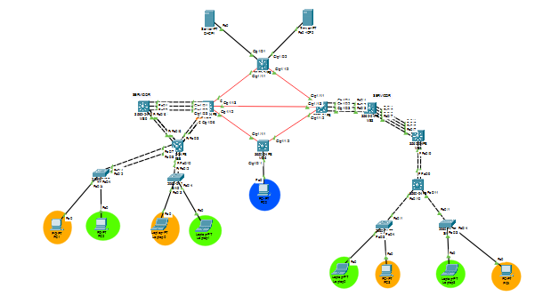
</p>

---

## 2. Descripción por Áreas

### 2.1 Edificio Izquierdo
Alberga a los usuarios de las VLANs Naranja (10) y Verde (20). Cuenta con un Switch Multicapa como Core (MS9), un Switch de Distribución (MS8) y dos switches de acceso (SW1 y SW2). La redundancia de Capa 2 se maneja mediante EtherChannel y los enlaces troncales permiten el flujo hacia las puertas de enlace ubicadas en el Core.

<p align="center">
  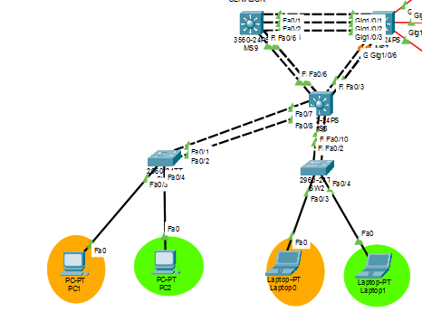
</p>

### 2.2 Edificio Derecho
Réplica de la arquitectura izquierda, dando servicio a las VLANs Naranja (30) y Verde (40). Su ruteo interno (inter-VLAN) es administrado por el Switch Multicapa Core MS3, el cual conecta mediante enlaces troncales hacia los switches de acceso SW3 y SW4.

<p align="center">
  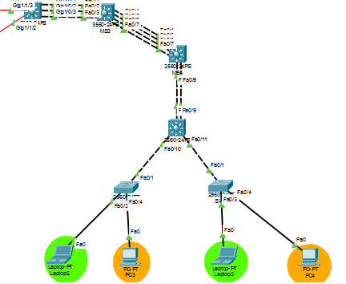
</p>

### 2.3 Anillo MAN y Servicios Centralizados
Compuesto por 4 Switches Multicapa (MS1, MS2, MS6, MS7) conectados en anillo mediante enlaces de fibra óptica enrutados (Capa 3). Este núcleo transporta el tráfico OSPF, provee acceso a los Servidores DHCP físicos centralizados (conectados a MS1) y el MS6 brinda acceso exclusivo y seguro a la VLAN de Administración (99).

<p align="center">
  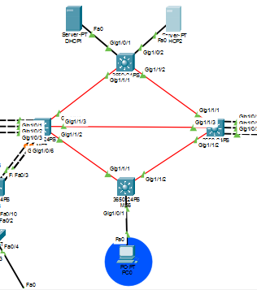
</p>

---

## 3. Direccionamiento IP y Asignación de VLANs

Se utilizó la subred base `192.188.48.0/24` calculada a partir del número de carnet, aplicando VLSM para dividirla en subredes `/27` para las VLANs de usuarios. Adicionalmente, la subred `10.4.48.0/24` se segmentó en bloques `/30` para los enlaces punto a punto del anillo MAN de fibra óptica.

| VLAN ID | Nombre de la VLAN | Edificio | Dirección de Red | Gateway (SVI) |
| :--- | :--- | :--- | :--- | :--- |
| **10** | VLAN_Naranja_EdificioIZQ_202300848 | Izquierdo | 192.188.48.0 /27 | 192.188.48.1 |
| **20** | VLAN_Verde_EdificioIZQ_202300848 | Izquierdo | 192.188.48.32 /27 | 192.188.48.33 |
| **30** | VLAN_Naranja_EdificioDER_202300848 | Derecho | 192.188.48.64 /27 | 192.188.48.65 |
| **40** | VLAN_Verde_EdificioDER_202300848 | Derecho | 192.188.48.96 /27 | 192.188.48.97 |
| **99** | VLAN_ADMIN_EdificioADMIN_202300848 | Central (MS6) | 192.188.48.128 /27 | 192.188.48.129 |

---

## 4. Justificación de Enrutamiento (OSPF) y DHCP Relay

*   **OSPF:** Al tener un número de carnet terminado en dígito par (48), el diseño exigía el protocolo OSPF. Se configuró un área única (Area 0) sobre los enlaces de Capa 3 del anillo MAN. Los switches Core (MS9 y MS3) y el switch de Administración (MS6) redistribuyen sus redes locales (VLANs) hacia el proceso OSPF para alcanzar convergencia total.
*   **DHCP Relay:** Dado que los dispositivos finales tienen prohibido el uso de direccionamiento estático, se instalaron dos Servidores DHCP en la red MAN. Para que las solicitudes de broadcast de las computadoras llegaran a estos servidores, se configuró el comando `ip helper-address` en todas las interfaces virtuales (SVIs) de los Gateways, reenviando los paquetes DHCP unicast hacia las IPs `10.4.48.30` y `10.4.48.34`.

---

## 5. Justificación de Listas de Control de Acceso (ACLs)

Para garantizar la segmentación de seguridad dictada por los requerimientos, se aplicaron Listas de Control de Acceso Extendidas en dirección de entrada (`in`) dentro de los Gateways (SVIs) de los switches Core.

*   **Aislamiento por Colores:** Las políticas permiten el tráfico hacia la subred del mismo color en el edificio opuesto, pero aplican un `deny ip any any` para bloquear la comunicación con el color contrario.
*   **Excepciones de Red:** Se insertaron reglas de tipo `permit udp any any eq bootps` al inicio de las listas para evitar que la regla de denegación global destruyera el tráfico de asignación de direcciones DHCP.
*   **Acceso Unidireccional (VLAN ADMIN):** Mediante el uso de los parámetros `established` y `echo-reply`, la red permite que el tráfico de respuesta regrese a la PC de Administración cuando esta inicia una conexión, pero descarta proactivamente cualquier paquete TCP o ICMP que las VLANs Naranja o Verde intenten iniciar hacia la red `192.188.48.128/27`.

---

## 6. Comandos Utilizados por Dispositivo

Se documenta la configuración lógica y de enrutamiento aplicada a los nodos críticos de la infraestructura, abarcando los switches de acceso, distribución y el núcleo de fibra óptica.

### 6.1 Anillo MAN: Switch MS1 (Arriba / Conexión DHCP)

```bash
enable
configure terminal
ip routing

! Interfaces de Fibra Óptica (Capa 3) hacia el Anillo
interface GigabitEthernet1/1/1
 no switchport
 ip address 10.4.48.1 255.255.255.252
 no shutdown
exit

interface GigabitEthernet1/1/2
 no switchport
 ip address 10.4.48.5 255.255.255.252
 no shutdown
exit

! Interfaces hacia los Servidores DHCP físicos
interface GigabitEthernet1/0/1
 no switchport
 ip address 10.4.48.29 255.255.255.252
 no shutdown
exit

interface GigabitEthernet1/0/2
 no switchport
 ip address 10.4.48.33 255.255.255.252
 no shutdown
exit

! Proceso de Enrutamiento OSPF
router ospf 1
 network 10.4.48.0 0.0.0.3 area 0
 network 10.4.48.4 0.0.0.3 area 0
 network 10.4.48.28 0.0.0.3 area 0
 network 10.4.48.32 0.0.0.3 area 0
exit
do write
```

### 6.2 Anillo MAN: Switch MS7 (Izquierda)

```bash
enable
configure terminal
ip routing

! Interfaces hacia el Anillo y Enlace Central
interface GigabitEthernet1/1/1
 no switchport
 ip address 10.4.48.2 255.255.255.252
 no shutdown
exit

interface GigabitEthernet1/1/2
 no switchport
 ip address 10.4.48.9 255.255.255.252
 no shutdown
exit

interface GigabitEthernet1/1/3
 no switchport
 ip address 10.4.48.17 255.255.255.252
 no shutdown
exit

! Enlace hacia el Edificio Izquierdo (MS9) vía VLAN Nativa
interface vlan 1
 ip address 10.4.48.21 255.255.255.252
 no shutdown
exit

! Proceso de Enrutamiento OSPF
router ospf 1
 network 10.4.48.0 0.0.0.3 area 0
 network 10.4.48.8 0.0.0.3 area 0
 network 10.4.48.16 0.0.0.3 area 0
 network 10.4.48.20 0.0.0.3 area 0
exit
do write
```

### 6.3 Anillo MAN: Switch MS2 (Derecha)

```bash
enable
configure terminal
ip routing

! Interfaces hacia el Anillo y Enlace Central
interface GigabitEthernet1/1/1
 no switchport
 ip address 10.4.48.6 255.255.255.252
 no shutdown
exit

interface GigabitEthernet1/1/2
 no switchport
 ip address 10.4.48.13 255.255.255.252
 no shutdown
exit

interface GigabitEthernet1/1/3
 no switchport
 ip address 10.4.48.18 255.255.255.252
 no shutdown
exit

! Enlace hacia el Edificio Derecho (MS3) vía VLAN Nativa
interface vlan 1
 ip address 10.4.48.25 255.255.255.252
 no shutdown
exit

! Proceso de Enrutamiento OSPF
router ospf 1
 network 10.4.48.4 0.0.0.3 area 0
 network 10.4.48.12 0.0.0.3 area 0
 network 10.4.48.16 0.0.0.3 area 0
 network 10.4.48.24 0.0.0.3 area 0
exit
do write
```

### 6.4 Anillo MAN: Switch MS6 (Abajo / Administración)

```bash
enable
configure terminal
ip routing

! Interfaces de Fibra Óptica hacia el Anillo
interface GigabitEthernet1/1/1
 no switchport
 ip address 10.4.48.10 255.255.255.252
 no shutdown
exit

interface GigabitEthernet1/1/2
 no switchport
 ip address 10.4.48.14 255.255.255.252
 no shutdown
exit

! Creación de VLAN de Administración local y SVI
vlan 99
 name VLAN_ADMIN_EdificioADMIN_202300848
exit

interface vlan 99
 ip address 192.188.48.129 255.255.255.224
 ip helper-address 10.4.48.30
 no shutdown
exit

! Asignación de puerto de Acceso para PC0
interface GigabitEthernet1/0/1
 switchport mode access
 switchport access vlan 99
 spanning-tree portfast
exit

! Proceso de Enrutamiento OSPF
router ospf 1
 network 10.4.48.8 0.0.0.3 area 0
 network 10.4.48.12 0.0.0.3 area 0
 network 192.188.48.128 0.0.0.31 area 0
exit
do write
```

### 6.5 Edificio Izquierdo: Core Switch (MS9)

```bash
enable
configure terminal
ip routing

! Creación de Gateways Inter-VLAN y Relay
interface vlan 10
 ip address 192.188.48.1 255.255.255.224
 ip helper-address 10.4.48.30
 ip access-group ACL_NARANJA_IZQ in
 no shutdown
exit

interface vlan 20
 ip address 192.188.48.33 255.255.255.224
 ip helper-address 10.4.48.30
 ip access-group ACL_VERDE_IZQ in
 no shutdown
exit

! Enlace hacia MAN (MS7)
interface vlan 1
 ip address 10.4.48.22 255.255.255.252
 no shutdown
exit

! Configuración de Enlaces Troncales hacia MS8
interface port-channel 2
 switchport trunk encapsulation dot1q
 switchport mode trunk
 switchport trunk allowed vlan all
exit

! Proceso OSPF
router ospf 1
 network 10.4.48.20 0.0.0.3 area 0
 network 192.188.48.0 0.0.0.31 area 0
 network 192.188.48.32 0.0.0.31 area 0
exit

! Configuración de Listas de Control de Acceso
ip access-list extended ACL_NARANJA_IZQ
 permit udp any any eq bootps
 permit udp any any eq bootpc
 permit ip 192.188.48.0 0.0.0.31 192.188.48.0 0.0.0.31
 permit ip 192.188.48.0 0.0.0.31 192.188.48.64 0.0.0.31
 permit tcp 192.188.48.0 0.0.0.31 192.188.48.128 0.0.0.31 established
 permit icmp 192.188.48.0 0.0.0.31 192.188.48.128 0.0.0.31 echo-reply
 deny ip any any
exit

ip access-list extended ACL_VERDE_IZQ
 permit udp any any eq bootps
 permit udp any any eq bootpc
 permit ip 192.188.48.32 0.0.0.31 192.188.48.32 0.0.0.31
 permit ip 192.188.48.32 0.0.0.31 192.188.48.96 0.0.0.31
 permit tcp 192.188.48.32 0.0.0.31 192.188.48.128 0.0.0.31 established
 permit icmp 192.188.48.32 0.0.0.31 192.188.48.128 0.0.0.31 echo-reply
 deny ip any any
exit
do write
```

### 6.6 Edificio Izquierdo: Switch de Distribución (MS8)

```bash
enable
configure terminal

! Enlaces Troncales y EtherChannel hacia MS9 y Acceso
interface port-channel 2
 switchport trunk encapsulation dot1q
 switchport mode trunk
 switchport trunk allowed vlan all
exit

interface port-channel 3
 switchport trunk encapsulation dot1q
 switchport mode trunk
 switchport trunk allowed vlan all
exit

interface port-channel 4
 switchport trunk encapsulation dot1q
 switchport mode trunk
 switchport trunk allowed vlan all
exit
do write
```

### 6.7 Edificio Izquierdo: Switches de Acceso (SW1 y SW2)

*(Configuración idéntica aplicada a ambos nodos)*

```bash
enable
configure terminal

! Creación de VLANs locales
vlan 10
 name VLAN_Naranja_EdificioIZQ_202300848
vlan 20
 name VLAN_Verde_EdificioIZQ_202300848
exit

! Configuración Troncal hacia Distribución
interface FastEthernet0/1
 switchport mode trunk
 switchport trunk allowed vlan all
exit

! Asignación de Puertos de Acceso a Computadoras
interface FastEthernet0/3
 switchport mode access
 switchport access vlan 10
 spanning-tree portfast
exit

interface FastEthernet0/4
 switchport mode access
 switchport access vlan 20
 spanning-tree portfast
exit
do write
```

### 6.8 Edificio Derecho: Core Switch (MS3)

```bash
enable
configure terminal
ip routing

! Creación de Gateways Inter-VLAN y Relay
interface vlan 30
 ip address 192.188.48.65 255.255.255.224
 ip helper-address 10.4.48.34
 ip access-group ACL_NARANJA_DER in
 no shutdown
exit

interface vlan 40
 ip address 192.188.48.97 255.255.255.224
 ip helper-address 10.4.48.34
 ip access-group ACL_VERDE_DER in
 no shutdown
exit

! Enlace hacia MAN (MS2)
interface vlan 1
 ip address 10.4.48.26 255.255.255.252
 no shutdown
exit

! Proceso OSPF
router ospf 1
 network 10.4.48.24 0.0.0.3 area 0
 network 192.188.48.64 0.0.0.31 area 0
 network 192.188.48.96 0.0.0.31 area 0
exit

! Configuración de Listas de Control de Acceso
ip access-list extended ACL_NARANJA_DER
 permit udp any any eq bootps
 permit udp any any eq bootpc
 permit ip 192.188.48.64 0.0.0.31 192.188.48.64 0.0.0.31
 permit ip 192.188.48.64 0.0.0.31 192.188.48.0 0.0.0.31
 permit tcp 192.188.48.64 0.0.0.31 192.188.48.128 0.0.0.31 established
 permit icmp 192.188.48.64 0.0.0.31 192.188.48.128 0.0.0.31 echo-reply
 deny ip any any
exit

ip access-list extended ACL_VERDE_DER
 permit udp any any eq bootps
 permit udp any any eq bootpc
 permit ip 192.188.48.96 0.0.0.31 192.188.48.96 0.0.0.31
 permit ip 192.188.48.96 0.0.0.31 192.188.48.32 0.0.0.31
 permit tcp 192.188.48.96 0.0.0.31 192.188.48.128 0.0.0.31 established
 permit icmp 192.188.48.96 0.0.0.31 192.188.48.128 0.0.0.31 echo-reply
 deny ip any any
exit
do write
```

### 6.9 Edificio Derecho: Switches de Acceso (SW3 y SW4)

*(Configuración idéntica aplicada a ambos nodos)*

```bash
enable
configure terminal

! Creación de VLANs locales
vlan 30
 name VLAN_Naranja_EdificioDER_202300848
vlan 40
 name VLAN_Verde_EdificioDER_202300848
exit

! Configuración Troncal hacia Core
interface FastEthernet0/1
 switchport mode trunk
 switchport trunk allowed vlan all
exit

! Asignación de Puertos de Acceso a Computadoras
interface FastEthernet0/4
 switchport mode access
 switchport access vlan 30
 spanning-tree portfast
exit

interface FastEthernet0/3
 switchport mode access
 switchport access vlan 40
 spanning-tree portfast
exit
do write
```

---

## 7. Pruebas de Conectividad 

### 7.1 Pings Exitosos (Comunicación Autorizada)
La siguiente captura evidencia que el tráfico inter-edificios validado por las ACL fluye correctamente, verificando pings entre máquinas de la misma VLAN (ej. Naranja a Naranja) y pings originados desde la VLAN de Administración (PC0) hacia los dispositivos finales.
<p align="center">
  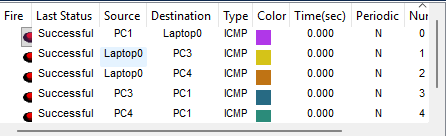
</p>
<p align="center">
  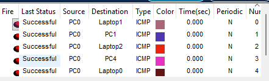
</p>


### 7.2 Pings Fallidos (Bloqueos Activos)
Se comprueba el filtrado de Capa 3. Los paquetes enviados entre VLANs de colores distintos son bloqueados (Failed), demostrando el correcto funcionamiento de la política `deny ip any any`. Asimismo, se bloquean los paquetes ICMP iniciados desde los usuarios hacia la PC de Administración.
<p align="center">
  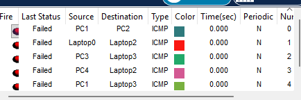
</p>
<p align="center">
  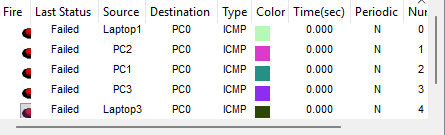
</p>
---

## 8. Capturas de Verificación 

### 8.1 Estado de Adyacencias OSPF en el núcleo (MS1)
Verifica la topología FULL del anillo OSPF y las conexiones a las subredes del área 0.
<p align="center">
  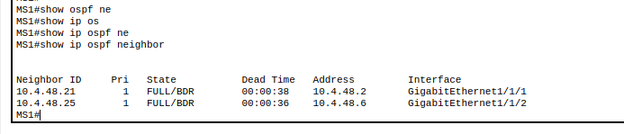
</p>

### 8.2 Listas de Control de Acceso (ACLs) aplicadas en el Core
Muestra las sentencias procesadas con sus respectivos matches de denegación en los routers virtuales.
<p align="center">
  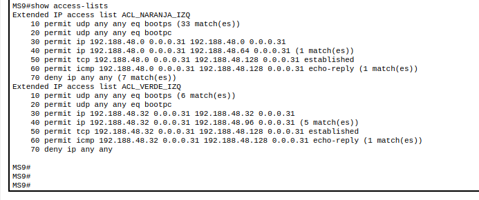
</p>
<p align="center">
  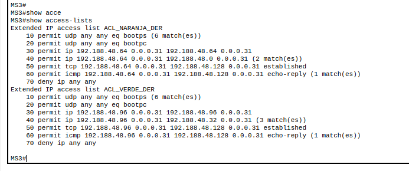
</p>


### 8.3 Asignación de VLANs en Acceso (SW1)
Confirma la activación de los puertos correspondientes en las VLANs de Naranja y Verde.
<p align="center">
  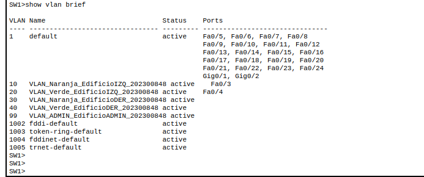
</p>

### 8.4 Estado de enlaces troncales EtherChannel (MS8)
Confirma la agregación de enlaces en Capa 2 operativa hacia el acceso y núcleo.
<p align="center">
  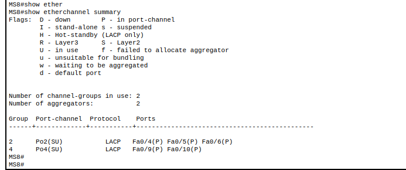
</p>

### 8.5 Concesión dinámica de IP mediante DHCP Relay (PC ADMIN)
Valida el cruce correcto de la solicitud DHCP a través del túnel OSPF hasta el servidor centralizado y la correcta configuración de la máscara e IP de Gateway.
  
<p align="center">
  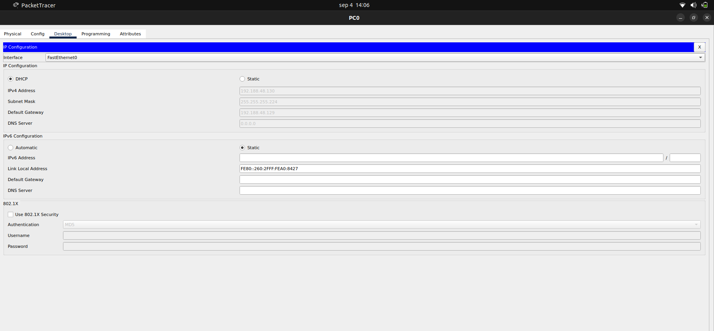
</p>