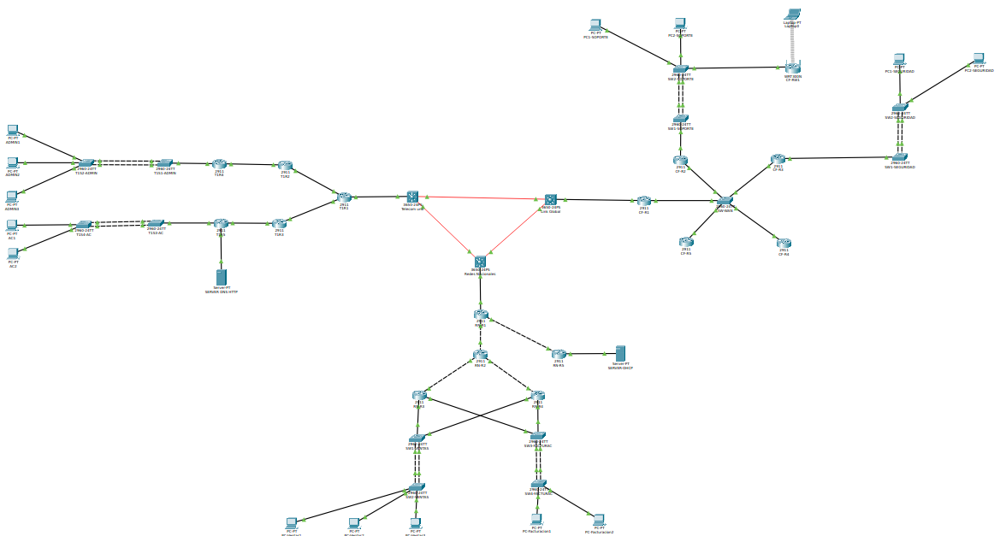
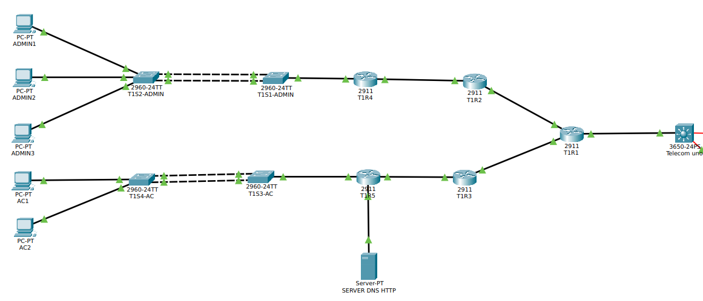
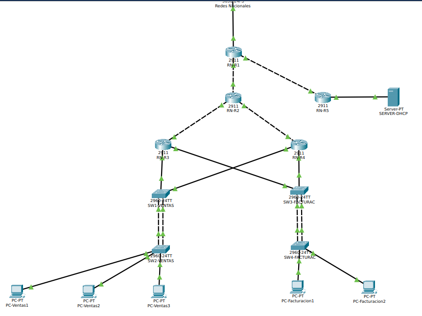
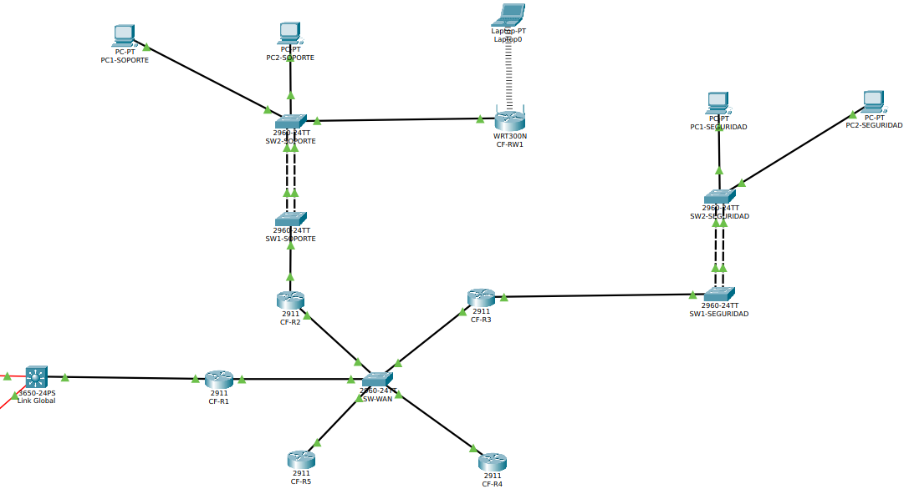
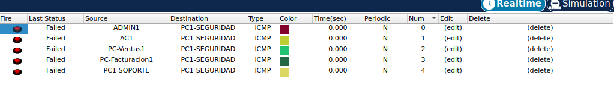
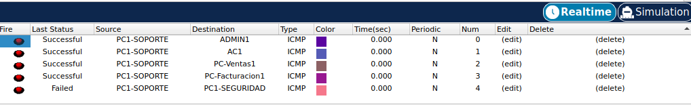
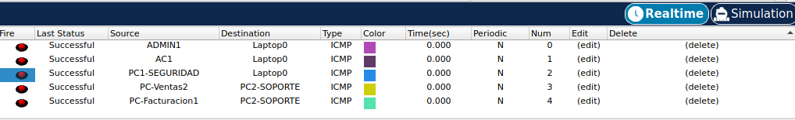
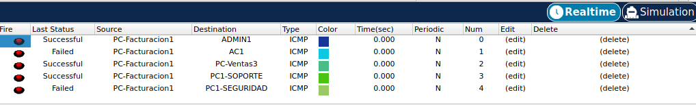

# Manual Técnico - Proyecto 2: Conectando al País

## 1. Introducción
El presente documento detalla la implementación técnica del Proyecto 2 del curso Redes de Computadoras 2, el cual interconecta tres Proveedores de Servicio de Internet (ISP): Telecom Uno, Redes Nacionales y Link Global (Conexiones Futuras). El diseño asegura escalabilidad, redundancia y enrutamiento dinámico eficiente entre distintos dominios administrativos utilizando OSPF, EIGRP y BGP. Se aplican políticas estrictas de control de tráfico para asegurar el cumplimiento de las reglas de negocio establecidas.

## 2. Direccionamiento y Subneteo (VLSM)
Basado en el carné **202300848** (donde el último dígito X=8), se derivaron las direcciones base solicitadas en la rúbrica. Para optimizar el espacio de direcciones y separar correctamente los dominios de difusión (broadcast domains) de cada departamento, se implementó el método de Máscaras de Subred de Longitud Variable (VLSM).

### 2.1 Justificación y Cálculos de Subneteo

**1. Enlaces Punto a Punto (Interconexiones BGP)**
La red base otorgada fue `192.168.48.0/16`. Dado que los enlaces directos entre routers (Point-to-Point) únicamente requieren 2 direcciones IP útiles, se decidió subnetear con una máscara `/30` (`255.255.255.252`).
- Fórmula de Host: $2^2 - 2 = 2$ IPs útiles (evitando el desperdicio masivo de IPs de una /24).

**2. Redes LAN Departamentales**
Las redes LAN base otorgadas fueron bloques `/24` (Ej. `172.16.18.0/24`). Para acomodar los múltiples departamentos en cada ISP y dejar un margen de crecimiento para el requisito de "al menos 5 hosts" por departamento, se estandarizó un subneteo utilizando una máscara `/26` (`255.255.255.192`).
- Fórmula de Subredes: $2^2 = 4$ subredes por ISP.
- Fórmula de Hosts: $2^6 - 2 = 62$ IPs útiles por departamento.
- Este diseño estandarizado facilitó la creación de las Listas de Control de Acceso (usando la Wildcard `0.0.0.63`) y la configuración uniforme de los Pools DHCP.

### 2.2 Tabla de Asignación de Direccionamiento IP

| ISP / Región | Departamento | Dirección de Red | Máscara | Rango Utilizable | Broadcast |
| :--- | :--- | :--- | :--- | :--- | :--- |
| **Telecom Uno** | Administración | `172.16.18.0` | `/26` | `.1` - `.62` | `.63` |
| **Telecom Uno** | ATC | `172.16.18.64` | `/26` | `.65` - `.126` | `.127` |
| **Telecom Uno** | Servidores | `172.16.18.128` | `/26` | `.129` - `.190` | `.191` |
| **Redes Nacionales** | Ventas | `172.16.28.0` | `/26` | `.1` - `.62` | `.63` |
| **Redes Nacionales** | Facturación | `172.16.28.64` | `/26` | `.65` - `.126` | `.127` |
| **Conexiones Futuras**| Soporte | `172.16.32.0` | `/26` | `.1` - `.62` | `.63` |
| **Conexiones Futuras**| Seguridad | `172.16.32.64` | `/26` | `.65` - `.126` | `.127` |

### 2.3 Tabla de Enlaces WAN (Punto a Punto)

| Enlace BGP | Red Base | Dirección de Red | Máscara | IP Router 1 | IP Router 2 |
| :--- | :--- | :--- | :--- | :--- | :--- |
| Telecom Uno ➔ Redes N. | `192.168.48.0/16` | `192.168.48.0` | `/30` | `.1` | `.2` |
| Telecom Uno ➔ Conexiones F. | `192.168.48.0/16` | `192.168.48.4` | `/30` | `.5` | `.6` |
| Redes N. ➔ Conexiones F. | `192.168.48.0/16` | `192.168.48.8` | `/30` | `.9` | `.10` |

## 3. Topologías y Tecnologías Implementadas


### 3.1 Telecom Uno (ISP 1)
- **Topología:** Árbol.
- **Enrutamiento:** OSPF.
- **Servicios:** Aloja el servidor DNS y HTTP (`172.16.18.130`). Proporciona resolución de nombres para el dominio estático `www.proyecto2_202300848.com`.
- **Alta Disponibilidad:** Configuración de EtherChannel (LACP) entre los switches de distribución y acceso.



### 3.2 Redes Nacionales (ISP 2)
- **Topología:** Modelo Jerárquico (Core, Distribución, Acceso).
- **Enrutamiento:** OSPF.
- **Servicios:** Aloja el servidor DHCP central (`172.16.28.130`), que asigna direcciones IP a toda la infraestructura nacional mediante el uso de `ip helper-address` configurado en las interfaces LAN de todos los routers remotos.
- **Alta Disponibilidad:** Implementación de redundancia de puerta de enlace (HSRP) para garantizar comunicación ininterrumpida, además de agregación de enlaces LACP.



### 3.3 Conexiones Futuras (ISP 3)
- **Topología:** Hub and Spoke.
- **Enrutamiento:** EIGRP (AS 10).
- **Servicios:** Implementación de red inalámbrica mediante un router WRT300N configurado con seguridad WPA2. Este equipo fue configurado en modo Bridge/Access Point para permitir el paso transparente de las solicitudes DHCP hacia la infraestructura cableada.



## 4. Enrutamiento Interdominio (BGP)
La interconexión de los tres ISPs se logró utilizando eBGP en los Switches Multicapa o Routers de Borde principales. Cada ISP fue configurado con su propio Sistema Autónomo y se redistribuyeron los protocolos internos (OSPF/EIGRP) hacia BGP y viceversa.

**Configuración base BGP (Ejemplo Conexiones Futuras):**
```text
router bgp 300
 bgp log-neighbor-changes
 neighbor 192.168.48.5 remote-as 200
 neighbor 192.168.48.9 remote-as 100
 redistribute eigrp 10
```


## 5. Listas de Control de Acceso (ACLs)
Para cumplir con las reglas de comunicación estrictas, se implementaron ACLs Extendidas. Se garantizó el paso de los servicios críticos (DHCP, DNS y HTTP) mientras se bloqueaba el tráfico no autorizado entre departamentos.

### Seguridad
#### Entrada

#### Salida


### Soporte
#### Entrada

#### Entrada


### Ventas
#### Entrada


### Administracion
#### Entrada


### Facturacion
#### Entrada


### ATENCION AL CLIENTE
#### Entrada

---

## 6. Resolución de Problemas (Troubleshooting)
Durante el desarrollo del proyecto y las fases de prueba de conectividad, se presentaron diversos desafíos técnicos de alto nivel que fueron diagnosticados y resueltos exitosamente, demostrando el dominio de las tecnologías empleadas:

### 6.1 Bucles de Enrutamiento por EIGRP Auto-Summary
- **Problema:** El switch multicapa de la interconexión BGP no podía hacer ping al router de Soporte (`CF-R2`), a pesar de que los equipos intermedios sí tenían conectividad.
- **Causa Raíz:** Se detectó que EIGRP estaba realizando una sumarización automática (`auto-summary`) en las fronteras de red con clase, anunciando la ruta global `172.16.0.0/16` en lugar de las subredes específicas `/26`. Esto causaba un choque de subredes con las otras redes ISP propagadas por BGP, ocasionando que los paquetes se enviaran al ISP equivocado.
- **Solución:** Se deshabilitó el resumen automático globalmente aplicando el comando `no auto-summary` en todos los procesos `router eigrp 10`. Esto forzó la propagación de prefijos específicos (Longest Prefix Match), habilitando el enrutamiento exitoso de extremo a extremo y restaurando las respuestas del servidor DHCP.

### 6.2 Bloqueo de DHCP por NAT Involuntario (Router Inalámbrico WRT300N)
- **Problema:** Los equipos de Soporte y la Laptop no recibían direccionamiento IP del servidor DHCP centralizado, generando IPs `169.254.x.x` (APIPA).
- **Causa Raíz:** Se descubrió que el router inalámbrico WRT300N estaba conectado al switch principal a través del puerto `Internet` (WAN). Esto activaba la función de NAT nativa del dispositivo, bloqueando y descartando los paquetes de difusión `DHCP Discover`.
- **Solución:** Se migró el cable físico del puerto `Internet` hacia el puerto `Ethernet 1` del router WRT300N. Esta acción convirtió el equipo en un Bridge/Access Point transparente en capa 2, permitiendo que las solicitudes DHCP fluyeran libremente hacia el router `CF-R2` y su respectivo `ip helper-address`.

### 6.3 Conflictos por IPs Duplicadas (Inestabilidad en Adyacencias EIGRP)
- **Problema:** El protocolo EIGRP en la topología Hub and Spoke colapsaba constantemente, mostrando mensajes de consola `%DUAL-5-NBRCHANGE... retry limit exceeded`.
- **Causa Raíz:** Una auditoría de configuración reveló que dos routers (`CF-R2` y `CF-R3`) tenían la misma dirección IP asignada en su interfaz WAN, provocando tormentas de paquetes y negación del servicio de enrutamiento.
- **Solución:** Se corrigió el archivo de script de inicialización y se reconfiguraron las interfaces con las IPs correctas (`.130` y la correspondiente de Seguridad), estabilizando las adyacencias EIGRP en cuestión de segundos.

### 6.4 Intercambio de Cables e Interfaces Físicas Invertidas
- **Problema:** Fallo total de comunicación entre el router central (`CF-R1`) y el router de Soporte (`CF-R2`).
- **Causa Raíz:** Se identificó mediante inspección visual y análisis de la tabla de enrutamiento que las conexiones físicas de `CF-R2` estaban invertidas: la interfaz configurada para la red LAN estaba conectada al puerto hacia la WAN y viceversa.
- **Solución:** Se eliminaron los cables y se procedió a realizar un cableado estructurado correcto, respetando la estandarización (`Gig0/0` para WAN, `Gig0/1` para LAN), restableciendo la comunicación de Capa 3 inmediatamente.

### 6.5 Inestabilidad de Conexiones por Balanceo de Carga OSPF en Entorno HSRP
- **Problema:** Los pings desde Ventas hacia Soporte mostraban intermitencia severa (flapping), alternando entre paquetes exitosos y perdidos.
- **Causa Raíz:** Al contar con redundancia física obligatoria (cables cruzados) para soportar HSRP, OSPF interpretó ambas rutas hacia la LAN como de igual costo. Esto generó un balanceo de carga asimétrico en el retorno de los paquetes. La mitad del tráfico regresaba por el router Standby, el cual descartaba los paquetes debido a políticas locales o falta de estado.
- **Solución:** Se implementó Enrutamiento Simétrico manipulando la métrica de OSPF. Se aplicó `ip ospf cost 50` en las interfaces de respaldo cruzadas, forzando a OSPF a utilizar siempre el router Activo HSRP para el tráfico de retorno, solucionando la intermitencia de inmediato.

### 6.6 Caída de Redundancia y Enrutamiento por Listas de Control de Acceso (Split-Brain)
- **Problema:** Tras aplicar las Listas de Control de Acceso (ACLs) estrictas, la red presentó colapsos, y ambos routers HSRP (RN-R3 y RN-R4) se declararon en estado "Active".
- **Causa Raíz:** La sentencia implícita `deny ip any any` al final de las ACLs bloqueó los paquetes multicast internos necesarios para la adyacencia de los protocolos de control, específicamente los "Hello" de OSPF (Protocolo 89) y de HSRP (UDP 1985/2029).
- **Solución:** Se incluyeron sentencias explícitas `permit ospf any any` y `permit udp any any eq 1985` en las ACLs extendidas, restableciendo la comunicación de los planos de control sin comprometer el plano de datos.

### 6.7 Ambigüedad de Reglas Administrativas (Conflictos de Tráfico)
- **Problema:** Los departamentos con reglas de salida estrictas (como Ventas y Facturación) no podían alcanzar a Soporte ni a Administración, a pesar de que estos últimos tenían la regla de "Entrada desde Todos".
- **Causa Raíz:** Un choque clásico de lógicas de firewall. Una regla estricta de salida en un origen bloquea el paquete antes de que pueda ser evaluado por la regla permisiva del destino. Además, ligeros desajustes en el tamaño de las subredes (VLSM) impedían el "match" exacto de la IP.
- **Solución:** Se interpretó a Soporte y Administración como "Excepciones Globales VIP". Se añadieron reglas de permiso explícitas hacia sus subredes usando origen `any` en las ACLs de los departamentos restrictivos, blindando la configuración contra problemas de subredes asimétricas.

---

## 7. Anexos: Scripts de Configuración
A continuación se presentan los enlaces a los scripts completos utilizados para configurar los equipos de la topología. Cada script ha sido documentado para facilitar su lectura y auditoría.

### Enrutamiento Interdominio (BGP)
- [Multicapa Conexiones Futuras](file:scripts/BGP/Multicapa_ConexionesFuturas.md)
- [Multicapa Redes Nacionales](file:scripts/BGP/Multicapa_RedesNacionales.md)
- [Multicapa Telecom Uno](file:scripts/BGP/Multicapa_TelecomUno.md)

### Conexiones Futuras (ISP 3)
- Routers: [CF-R1](file:scripts/Conexiones_Futuras/CF-R1.md), [CF-R2](file:scripts/Conexiones_Futuras/CF-R2.md), [CF-R3](file:scripts/Conexiones_Futuras/CF-R3.md), [CF-R4](file:scripts/Conexiones_Futuras/CF-R4.md), [CF-R5](file:scripts/Conexiones_Futuras/CF-R5.md)
- Switches Soporte: [SW1](file:scripts/Conexiones_Futuras/SW1-SOPORTE.md), [SW2](file:scripts/Conexiones_Futuras/SW2-SOPORTE.md)
- Switches Seguridad: [SW3](file:scripts/Conexiones_Futuras/SW3-SEGURIDAD.md), [SW4](file:scripts/Conexiones_Futuras/SW4-SEGURIDAD.md)

### Redes Nacionales (ISP 2)
- Routers Core/Distribución: [RN-R1](file:scripts/Redes_Nacionales/RN-R1.md), [RN-R2](file:scripts/Redes_Nacionales/RN-R2.md), [RN-R5](file:scripts/Redes_Nacionales/RN-R5.md)
- Routers Acceso (HSRP): [RN-R3 (Active/Standby)](file:scripts/Redes_Nacionales/RN-R3_HSRP.md), [RN-R4 (Active/Standby)](file:scripts/Redes_Nacionales/RN-R4_HSRP.md)
- Switches Ventas: [SW1](file:scripts/Redes_Nacionales/SW1-VENTAS.md), [SW2](file:scripts/Redes_Nacionales/SW2-VENTAS.md)
- Switches Facturación: [SW3](file:scripts/Redes_Nacionales/SW3-FACTURAC.md), [SW4](file:scripts/Redes_Nacionales/SW4-FACTURAC.md)

### Telecom Uno (ISP 1)
- Routers: [T1R1](file:scripts/Telecom_Uno/T1R1.md), [T1R2](file:scripts/Telecom_Uno/T1R2.md), [T1R3](file:scripts/Telecom_Uno/T1R3.md), [T1R4](file:scripts/Telecom_Uno/T1R4.md), [T1R5](file:scripts/Telecom_Uno/T1R5.md)
- Switches Administración: [T1S1](file:scripts/Telecom_Uno/T1S1-ADMIN.md), [T1S2](file:scripts/Telecom_Uno/T1S2-ADMIN.md)
- Switches ATC: [T1S3](file:scripts/Telecom_Uno/T1S3-AC.md), [T1S4](file:scripts/Telecom_Uno/T1S4-AC.md)
