# Manual Técnico — Proyecto 2: Integración de Operadores Nacionales

**Curso:** Redes de Computadoras 2 · Segundo Semestre 2026
**Estudiante:** Carné 202300848
**Entrega:** 23/10/2026

---

## 1. Introducción

El presente documento detalla la implementación técnica del Proyecto 2 del curso Redes de
Computadoras 2, el cual interconecta tres Proveedores de Servicio de Internet (ISP):

| ISP | AS | Topología | Enrutamiento interno | Servicio asignado |
| :--- | :--- | :--- | :--- | :--- |
| **FibraNet GT** | 100 | Árbol | OSPF área 0 | **DNS + HTTP/HTTPS** |
| **AndinaCom** | 200 | Jerárquica | OSPF área 0 | **DHCP a toda la topología** |
| **MoonLink** | 300 | Hub-and-spoke | EIGRP AS 10 | **Red inalámbrica (Wi-Fi)** |

El diseño asegura escalabilidad, redundancia y enrutamiento dinámico eficiente entre distintos
dominios administrativos utilizando OSPF, EIGRP y BGP. Se aplican políticas estrictas de control de
tráfico mediante ACLs extendidas para asegurar el cumplimiento de las reglas de negocio establecidas.

> **Nota de nomenclatura:** el enunciado original (`[RC2]`) nombraba a los ISPs *Telecom Uno*, *Redes
> Nacionales* y *Conexiones Futuras / Link Global*. El enunciado oficial los renombra a
> **FibraNet GT**, **AndinaCom** y **MoonLink**. Los *hostnames* de los dispositivos conservan los
> prefijos `T1` / `RN` / `CF` por continuidad con el archivo `.pkt`; la equivalencia está documentada
> en [`scripts/README.md`](scripts/README.md).

---

## 2. Direccionamiento y Subneteo (VLSM)

Basado en el carné **202300848**:

| Red asignada | Cálculo | Resultado |
| :--- | :--- | :--- |
| `172.16.1X.0/24` (X = último dígito = 8) | FibraNet GT | `172.16.18.0/24` |
| `172.16.2X.0/24` (X = último dígito = 8) | AndinaCom | `172.16.28.0/24` |
| `172.16.3X.0/24` (X = primer dígito = 2) | MoonLink | `172.16.32.0/24` |
| `192.168.XX.0/16` (XX = últimos 2 dígitos = 48) | Interconexión de routers / switches L3 | `192.168.48.0/16` |

### 2.1 Justificación de los cálculos

**1. Enlaces punto a punto (interconexión de routers y switches de capa 3)**

El enunciado asigna la red `192.168.XX.0/16` para *"conectar los routers o switches de capa 3"* y la
rúbrica 2.4 premia el *"subneteo eficiente de la red 192.168.X.0/16"*. Como cada enlace directo solo
requiere 2 direcciones útiles, se subneteó con máscara **`/30`**:

- Fórmula de hosts: `2² − 2 = 2` IPs útiles → cero desperdicio de direcciones.

**2. Redes LAN departamentales**

| ISP | Requisito del enunciado oficial | Máscara elegida | Hosts útiles |
| :--- | :--- | :--- | :--- |
| **FibraNet GT** | *"debe soportar hasta **75 hosts**"* | **`/25`** | `2⁷ − 2 =` **126** | 
| **AndinaCom** | *"queda a discreción del estudiante"* | `/26` | `2⁶ − 2 =` 62 | 
| **MoonLink** | *"deben soportar hasta **45 hosts**"* | `/26` | `2⁶ − 2 =` 62 |

> **Decisión de diseño clave (FibraNet GT):** el enunciado *original* dejaba el tamaño de las
> subredes a discreción, por lo que el diseño inicial usaba `/26` (62 hosts). El enunciado **oficial
> exige soportar hasta 75 hosts**, y 62 < 75, por lo que **FibraNet GT se rediseñó a `/25`**
> (126 hosts útiles). Como las dos `/25` consumen la totalidad de `172.16.18.0/24`, los enlaces punto
> a punto y el segmento de servidores de este ISP se movieron al bloque `192.168.48.0/16`, que es
> precisamente el que el enunciado destina a la conexión entre routers.

### 2.2 Tabla de direccionamiento — Redes LAN departamentales

| ISP | Departamento | Dirección de red | Máscara | Rango utilizable | Broadcast | Gateway |
| :--- | :--- | :--- | :--- | :--- | :--- | :--- |
| **FibraNet GT** | Administración | `172.16.18.0` | `/25` (`255.255.255.128`) | `.1` – `.126` | `.127` | `172.16.18.1` (T1R4) |
| **FibraNet GT** | Atención al Cliente | `172.16.18.128` | `/25` (`255.255.255.128`) | `.129` – `.254` | `.255` | `172.16.18.129` (T1R5) |
| **AndinaCom** | Ventas | `172.16.28.0` | `/26` (`255.255.255.192`) | `.1` – `.62` | `.63` | `172.16.28.1` (**HSRP**) |
| **AndinaCom** | Facturación | `172.16.28.64` | `/26` (`255.255.255.192`) | `.65` – `.126` | `.127` | `172.16.28.65` (**HSRP**) |
| **MoonLink** | Soporte | `172.16.32.0` | `/26` (`255.255.255.192`) | `.1` – `.62` | `.63` | `172.16.32.1` (CF-R2) |
| **MoonLink** | Seguridad | `172.16.32.64` | `/26` (`255.255.255.192`) | `.65` – `.126` | `.127` | `172.16.32.65` (CF-R3) |

### 2.3 Tabla de direccionamiento — Interconexión inter-ISP (`192.168.48.0/16`)

| Enlace (fibra óptica) | Red | Máscara | Extremo A | Extremo B |
| :--- | :--- | :--- | :--- | :--- |
| FibraNet GT ↔ AndinaCom | `192.168.48.0` | `/30` | `.1` (SW-BGP-FG) | `.2` (SW-BGP-AC) |
| AndinaCom ↔ MoonLink | `192.168.48.4` | `/30` | `.5` (SW-BGP-AC) | `.6` (SW-BGP-ML) |
| MoonLink ↔ FibraNet GT | `192.168.48.8` | `/30` | `.9` (SW-BGP-FG) | `.10` (SW-BGP-ML) |

### 2.4 Tabla de direccionamiento — Enlaces internos y servidores

**FibraNet GT**

| Enlace | Red | Máscara | Extremo A | Extremo B |
| :--- | :--- | :--- | :--- | :--- |
| SW-BGP-FG ↔ T1R1 | `192.168.48.32` | `/30` | `.33` (SW-BGP-FG) | `.34` (T1R1) |
| T1R1 ↔ T1R2 | `192.168.48.16` | `/30` | `.17` (T1R1) | `.18` (T1R2) |
| T1R1 ↔ T1R3 | `192.168.48.20` | `/30` | `.21` (T1R1) | `.22` (T1R3) |
| T1R2 ↔ T1R4 | `192.168.48.24` | `/30` | `.25` (T1R2) | `.26` (T1R4) |
| T1R3 ↔ T1R5 | `192.168.48.28` | `/30` | `.29` (T1R3) | `.30` (T1R5) |
| T1R5 ↔ Servidor DNS/HTTP/HTTPS | `192.168.48.48` | `/30` | `.49` (T1R5) | `.50` (Servidor) |

**AndinaCom**

| Enlace | Red | Máscara | Extremo A | Extremo B |
| :--- | :--- | :--- | :--- | :--- |
| SW-BGP-AC ↔ RN-R1 | `172.16.28.252` | `/30` | `.253` | `.254` |
| RN-R1 ↔ RN-R2 | `172.16.28.132` | `/30` | `.133` | `.134` |
| RN-R1 ↔ RN-R5 | `172.16.28.136` | `/30` | `.137` | `.138` |
| RN-R5 ↔ Servidor DHCP | `172.16.28.128` | `/30` | `.129` | `.130` |
| RN-R2 ↔ RN-R3 | `172.16.28.140` | `/30` | `.141` | `.142` |
| RN-R2 ↔ RN-R4 | `172.16.28.144` | `/30` | `.145` | `.146` |

**MoonLink**

| Enlace | Red | Máscara | Extremo A | Extremo B |
| :--- | :--- | :--- | :--- | :--- |
| SW-BGP-ML ↔ CF-R1 | `172.16.32.252` | `/30` | `.253` | `.254` |
| Red WAN multipunto (SW-WAN) | `172.16.32.128` | `/27` | CF-R1 `.129`, CF-R2 `.130`, CF-R3 `.131`, CF-R4 `.132`, CF-R5 `.133` | – |
| Loopback CF-R4 | `172.16.32.201` | `/32` | – | – |
| Loopback CF-R5 | `172.16.32.202` | `/32` | – | – |

### 2.5 Pools DHCP (servidor central en AndinaCom)

Servidor DHCP: `172.16.28.130` (AndinaCom, `RN-R5 g0/1`). Los routers de acceso de los tres ISPs
tienen `ip helper-address 172.16.28.130` en su interfaz LAN, lo que permite dar direccionamiento
cruzando dominios de enrutamiento.

| Pool (nombre en el `.pkt`) | Red | Máscara | Gateway | Start IP | DNS |
| :--- | :--- | :--- | :--- | :--- | :--- |
| `Pool Admin (FG)` | `172.16.18.0` | `255.255.255.128` | `172.16.18.1` | `172.16.18.2` | `192.168.48.50` |
| `Pool AC (FG)` | `172.16.18.128` | `255.255.255.128` | `172.16.18.129` | `172.16.18.130` | `192.168.48.50` |
| `Pool Ventas (RN)` | `172.16.28.0` | `255.255.255.192` | `172.16.28.1` (VIP HSRP) | `172.16.28.4` | `192.168.48.50` |
| `Pool Factura (RN)` | `172.16.28.64` | `255.255.255.192` | `172.16.28.65` (VIP HSRP) | `172.16.28.68` | `192.168.48.50` |
| `Pool Soporte (CF)` | `172.16.32.0` | `255.255.255.192` | `172.16.32.1` | `172.16.32.2` | `192.168.48.50` |
| `Pool Seguridad (CF)` | `172.16.32.64` | `255.255.255.192` | `172.16.32.65` | `172.16.32.66` | `192.168.48.50` |

> **Ajuste de los *Start IP* de Ventas y Facturación:** originalmente arrancaban en `.2` y `.66`,
> que son **exactamente** las direcciones de `RN-R3 g0/1` y `g0/2` (la pareja HSRP usa `.2`/`.3` y
> `.66`/`.67`). El servidor habría repartido direcciones ya ocupadas por routers, provocando un
> conflicto. Por eso arrancan en `.4` y `.68`.

Direcciones reservadas / excluidas de los pools: los *gateways* y VIP de HSRP (`.1` y `.129` de
FibraNet GT; `.1` y `.65` de AndinaCom y MoonLink), las interfaces de los routers en cada segmento
(`.2`/`.3` y `.66`/`.67` en AndinaCom) y `172.16.28.130` (el propio servidor DHCP).

> **Todos los dispositivos finales obtienen su dirección por DHCP**
---

## 3. Topologías y tecnologías implementadas


### 3.1 FibraNet GT (ISP 1 — AS 100)

- **Topología:** Árbol.
- **Enrutamiento:** OSPF área 0.
- **Servicios:** Aloja el servidor **DNS, HTTP y HTTPS** (`192.168.48.50`). Proporciona resolución
  de nombres para el dominio `www.proyecto2_202300848.com` a toda la topología.
- **Alta disponibilidad:** EtherChannel con **LACP** (`mode active` / `mode passive`) en los pares de
  switches de cada departamento.
- **Requisito de subneteo:** dos subredes **`/25`** de 126 hosts cada una (≥ 75 requeridos).
- **Scripts:** [`scripts/FibraNet_GT/`](scripts/FibraNet_GT/)


### 3.2 AndinaCom (ISP 2 — AS 200)

- **Topología:** Modelo jerárquico (núcleo, distribución y acceso).
- **Enrutamiento:** OSPF área 0.
- **Servicios:** Aloja el **servidor DHCP central** (`172.16.28.130`), que asigna direcciones IP a
  toda la infraestructura nacional mediante `ip helper-address` en las interfaces LAN de todos los
  routers de acceso de los tres ISPs.
- **Alta disponibilidad — redundancia de capa 3 obligatoria:** **HSRP** con dos grupos
  (grupo 10 para Ventas, grupo 20 para Facturación), `priority 110` + `preempt` en RN-R3 (activo).
  Se agregó `ip ospf cost 50` en los enlaces cruzados para forzar enrutamiento simétrico.
- **Scripts:** [`scripts/AndinaCom/`](scripts/AndinaCom/)


### 3.3 MoonLink (ISP 3 — AS 300)

- **Topología:** Hub-and-spoke.
- **Enrutamiento:** EIGRP (AS 10) con `no auto-summary` obligatorio.
- **Servicios:** Red inalámbrica mediante router **WRT300N** configurado con seguridad WPA2 y
  conectado por sus puertos **LAN** (modo bridge/access point) para permitir el paso transparente de
  las solicitudes DHCP hacia la infraestructura cableada.
- **Requisito de subneteo:** dos subredes **`/26`** de 62 hosts (≥ 45 requeridos).
- **Scripts:** [`scripts/MoonLink/`](scripts/MoonLink/)


### 3.4 Evidencia de convergencia y servicios

Capturas tomadas del `.pkt` final, que demuestran el funcionamiento de cada tecnología.

**Redundancia de capa 3 (HSRP) — un router Activo y uno Standby**

| `RN-R3` (activo) | `RN-R4` (standby) |
| :--- | :--- |
| 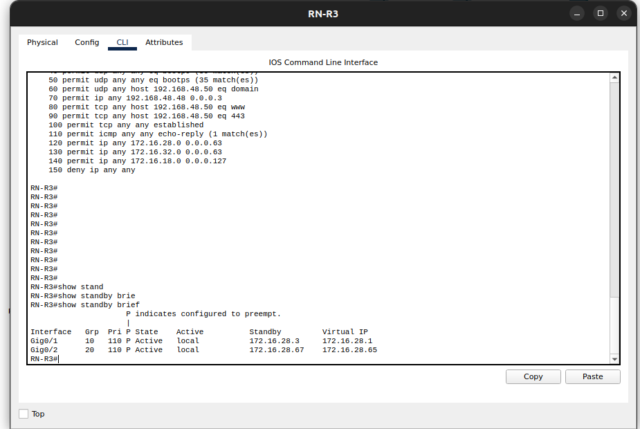 | 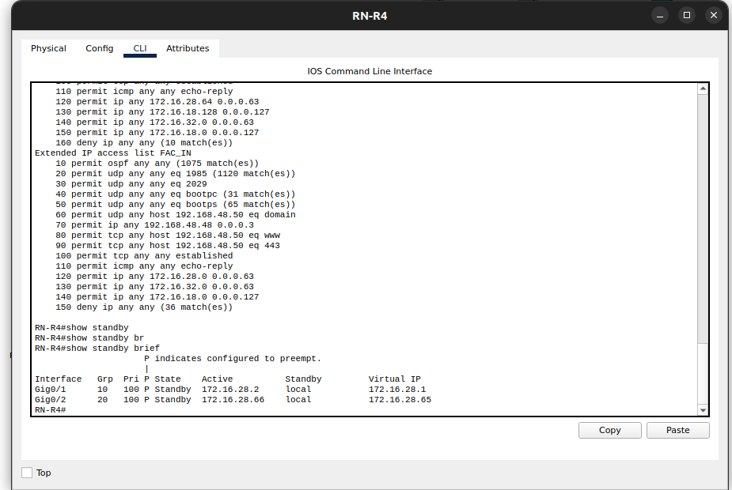 |
| Grupos 10 y 20 en estado **Active**, prioridad 110, `P` (preempt) | Grupos 10 y 20 en estado **Standby**, con el Activo remoto `.2` y `.66` |

**Vecinos eBGP en los tres routers de borde (interconexión interdominio)**

| `SW-BGP-FG` — AS 100 | `SW-BGP-AC` — AS 200 | `SW-BGP-ML` — AS 300 |
| :--- | :--- | :--- |
| 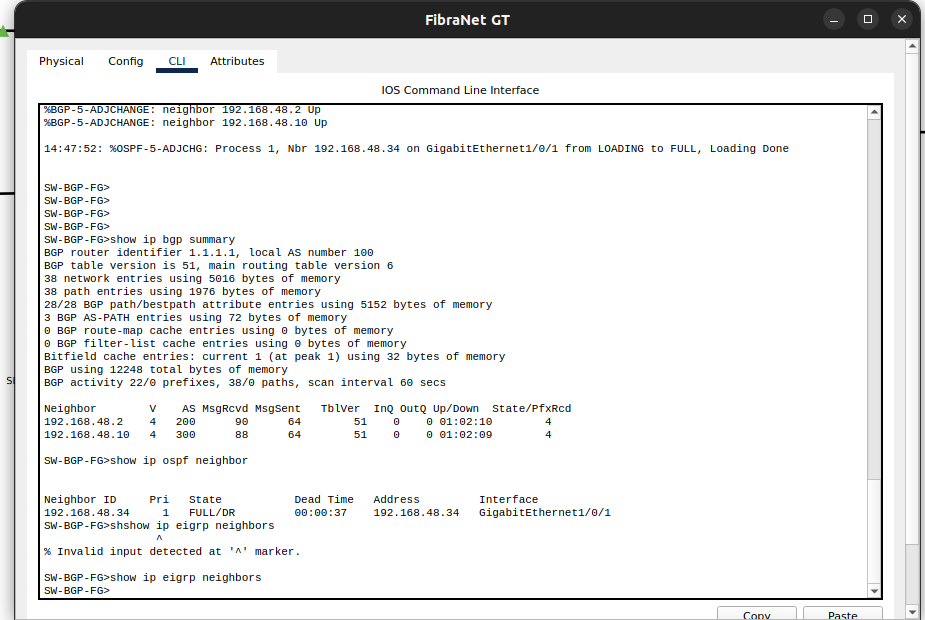 | 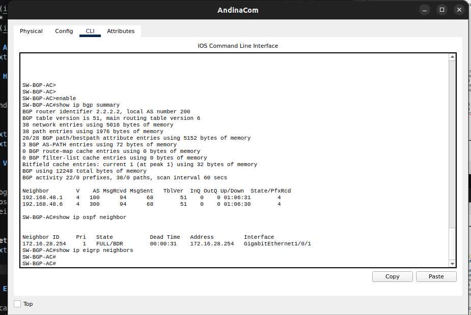 | 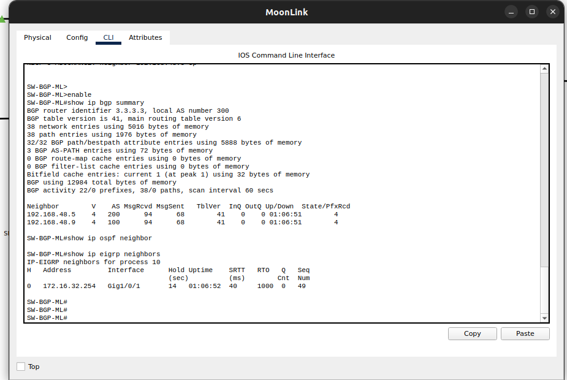 |
| Router-id `1.1.1.1` · vecinos `.2` (AS 200) y `.10` (AS 300) **Up** · OSPF con T1R1 en FULL/DR | Router-id `2.2.2.2` · vecinos `.1` (AS 100) y `.6` (AS 300) **Up** · OSPF con RN-R1 en FULL/BDR | Router-id `3.3.3.3` · vecinos `.5` (AS 200) y `.9` (AS 100) **Up** · vecino EIGRP `172.16.32.254` en UP |

**Agregación de enlaces (LACP) y direccionamiento por DHCP**

| EtherChannel en `T1S2-ADMIN` | DHCP en `PC-Ventas2` |
| :--- | :--- |
| 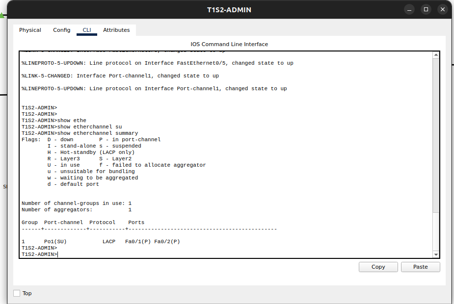 | 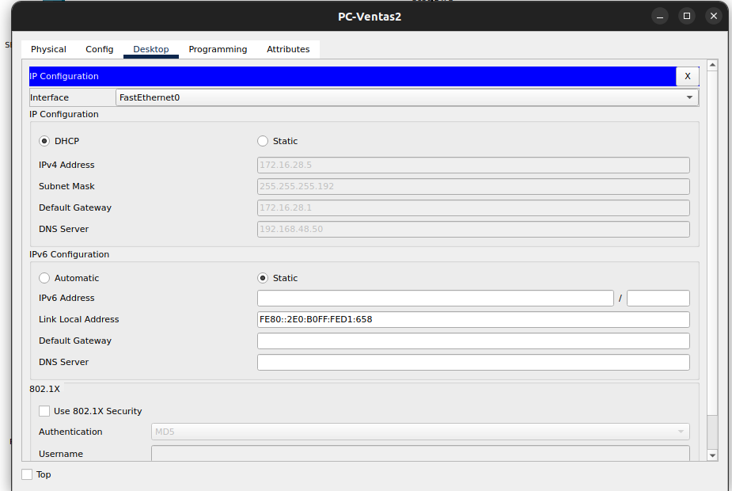 |
| `Po1(SU)` — protocolo **LACP**, puertos `Fa0/1(P)` y `Fa0/2(P)` en uso | IP **172.16.28.5/26** obtenida por **DHCP**, gateway `172.16.28.1` (**VIP de HSRP**) y DNS `192.168.48.50` |

**Servicio web por HTTPS desde AndinaCom**

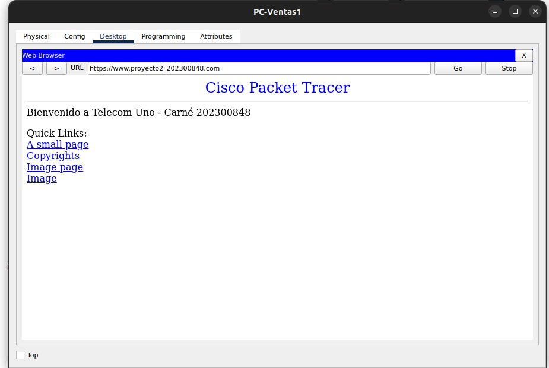

*`https://www.proyecto2_202300848.com` resuelto por el DNS de FibraNet GT y servido desde
`192.168.48.50`, demostrando ruteo extremo a extremo entre ISPs.*

---

## 4. Enrutamiento interdominio (BGP)

La interconexión de los tres ISPs se logró con **eBGP** en los switches multicapa de borde
(3650-24PS), conectados en la topología triangular de fibra óptica indicada por el enunciado.
Cada ISP usa su propio Sistema Autónomo y se redistribuyen los protocolos internos (OSPF/EIGRP)
hacia BGP y viceversa.

| Router de borde | AS | Vecinos eBGP |
| :--- | :--- | :--- |
| `SW-BGP-FG` | 100 | `192.168.48.2` (AS 200), `192.168.48.10` (AS 300) |
| `SW-BGP-AC` | 200 | `192.168.48.1` (AS 100), `192.168.48.6` (AS 300) |
| `SW-BGP-ML` | 300 | `192.168.48.5` (AS 200), `192.168.48.9` (AS 100) |

**Configuración base BGP (ejemplo MoonLink):**

```text
router bgp 300
 bgp log-neighbor-changes
 neighbor 192.168.48.5 remote-as 200
 neighbor 192.168.48.9 remote-as 100
 redistribute eigrp 10
 exit
```

### 4.1 Redistribución bidireccional (la clave de la conectividad extremo a extremo)

BGP solo intercambia rutas entre los **routers de borde**. Para que un PC de un departamento pueda
alcanzar la red de otro ISP, las rutas aprendidas por BGP deben inyectarse en el protocolo interno
del ISP, y viceversa. Se configura en **ambas direcciones** en cada switch multicapa:

| ISP | Del protocolo interno hacia BGP | De BGP hacia el protocolo interno |
| :--- | :--- | :--- |
| **FibraNet GT** (OSPF) | `redistribute ospf 1 subnets` | `redistribute bgp 100 subnets` |
| **AndinaCom** (OSPF) | `redistribute ospf 1 subnets` | `redistribute bgp 200 subnets` |
| **MoonLink** (EIGRP) | `redistribute eigrp 10` | `redistribute bgp 300 metric 10000 100 255 1 1500` |

```text
! Ejemplo: SW-BGP-ML (MoonLink) — las dos direcciones
router bgp 300
 redistribute eigrp 10
 exit
router eigrp 10
 redistribute bgp 300 metric 10000 100 255 1 1500
 exit
```

> **El parámetro `subnets` es obligatorio al redistribuir OSPF.** Sin él, Cisco IOS solo
> redistribuye redes **con clase** (`172.16.0.0/16`) y las subredes `/25` y `/26` **no se anuncian**;
> el resultado es que los demás ISPs no pueden alcanzar los departamentos y el servidor DHCP no puede
> responder a las `giaddr`. En **EIGRP** la redistribución exige declarar la **métrica** explícita
> (ancho de banda, retardo, confiabilidad, carga y MTU).

Scripts completos: [`scripts/BGP/`](scripts/BGP/)


---

## 5. Listas de Control de Acceso (ACLs)

Para cumplir con las reglas de comunicación del enunciado se implementaron **ACLs extendidas
aplicadas en sentido `in` sobre la interfaz LAN de cada departamento** (filtrado en el origen) —con
**una única excepción**: `SEC_OUT`, que va en sentido **`out`** porque es una ACL de retorno que
protege la entrada a Seguridad—, garantizando el paso de los servicios críticos (DHCP, DNS, HTTP y
HTTPS) y del plano de control (OSPF, EIGRP y HSRP) antes del `deny ip any any` implícito.

| ACL | Departamento | Equipo | Interfaz | Sentido |
| :--- | :--- | :--- | :--- | :--- |
| `ATC_IN` | Atención al Cliente | T1R5 | `g0/1` | in |
| `VENTAS_IN` | Ventas | RN-R3 y RN-R4 | `g0/1` | in |
| `FAC_IN` | Facturación | RN-R3 y RN-R4 | `g0/2` | in |
| `SEC_OUT` | Seguridad | CF-R3 | `g0/1` | **out** |
| *(ninguna)* | Administración | T1R4 | — | — |
| *(ninguna)* | Soporte | CF-R2 | — | — |

> **Administración y Soporte no llevan ACL por diseño:** su regla es "hablar y escuchar a todos", así
> que las restricciones se aplican en el **origen** de los departamentos que sí las necesitan. La
> restricción "nadie entra a Seguridad" se resuelve en el destino con `SEC_OUT` (sentido `out`), que
> solo permite tráfico de retorno.

### 5.1 Bloque común de las ACLs

Todas las ACLs de departamento incluyen, **antes del `deny ip any any`**, los permisos del plano de
control y de los servicios centrales. Sin ellos la red colapsa (véase el split-brain del §7.6):

```text
ip access-list extended ATC_IN
 ! --- Plano de control y servicios compartidos: NO filtrar ---
 permit ospf any any
 permit udp any any eq 1985              ! HSRP (grupos 10 y 20 de AndinaCom)
 permit udp any any eq bootpc
 permit udp any any eq bootps
 permit ip any 192.168.48.48 0.0.0.3     ! Servidor DNS/HTTP/HTTPS completo (192.168.48.50)
 ! --- Reglas de negocio del departamento ---
 permit tcp any any established
 permit icmp any any echo-reply
 permit ip any 172.16.28.0 0.0.0.63      ! ATC <-> Ventas
 permit ip any 172.16.32.0 0.0.0.63      ! ATC <-> Soporte
 permit ip any 172.16.18.0 0.0.0.127     ! ATC <-> Administracion
 deny   ip any any
 exit
interface g0/1
 ip access-group ATC_IN in
 exit
```

> **Nota sobre el permiso al servidor:** se autoriza el **segmento completo** del servidor
> (`192.168.48.48/30`), no solo el host, porque es un recurso compartido por toda la topología y así
> cubre DNS (UDP 53), HTTP (TCP 80), HTTPS (TCP 443) **e ICMP** (permite hacer ping al servidor, que
> es la evidencia usada en las pruebas).

- **Justificación completa de interfaz y sentido (requisito 4.2):** [`scripts/ACLs/README.md`](scripts/ACLs/README.md)
- **Configuración completa de cada ACL (línea por línea):** [`scripts/ACLs/`](scripts/ACLs/)
- **Matriz de pruebas (24 pruebas ICMP + servicios):** [`scripts/ACLs/MATRIZ_PRUEBAS.md`](scripts/ACLs/MATRIZ_PRUEBAS.md)

### 5.2 Reglas del enunciado y su cumplimiento

| Origen | Destino | Protocolo permitido | Resultado esperado | Implementado en |
| :--- | :--- | :--- | :--- | :--- |
| Seguridad | Cualquier depto | ICMP, TCP/80, TCP/443 | Exitoso | `SEC_OUT` permite solo el retorno; el origen no se filtra |
| Cualquier depto | Seguridad | — | Bloqueado | `SEC_OUT` (`out` en `CF-R3 g0/1`) |
| Soporte | Cualquier depto | ICMP, TCP/80, TCP/443 | Exitoso (salvo Seguridad) | sin ACL + `SEC_OUT` bloquea el ingreso |
| Administración | Cualquier depto | ICMP, TCP/80, TCP/443 | Exitoso (salvo Seguridad) | sin ACL + `SEC_OUT` bloquea el ingreso |
| Atención al Cliente ↔ Ventas | — | ICMP, TCP/80 | Exitoso | `ATC_IN` + `VENTAS_IN` |
| Atención al Cliente | Facturación | — | Bloqueado | `ATC_IN` no permite `172.16.28.64/26` |
| Facturación | Ventas | ICMP, TCP/80 | Exitoso | `VENTAS_IN` + `FAC_IN` |
| Facturación | Atención al Cliente | — | Bloqueado | `FAC_IN` no permite `172.16.18.128/25` |
| Ventas | Facturación y Atención al Cliente | ICMP, TCP/80 | Exitoso | `VENTAS_IN` |

### 5.3 Configuración de las ACLs en el simulador

Salida real de `show ip access-lists` en cada equipo (evidencia de la rúbrica 2.5):

| Equipo | ACLs visibles | Captura |
| :--- | :--- | :--- |
| `T1R5` | `ATC_IN` (con `permit ip any 192.168.48.48 0.0.0.3` al servidor) | 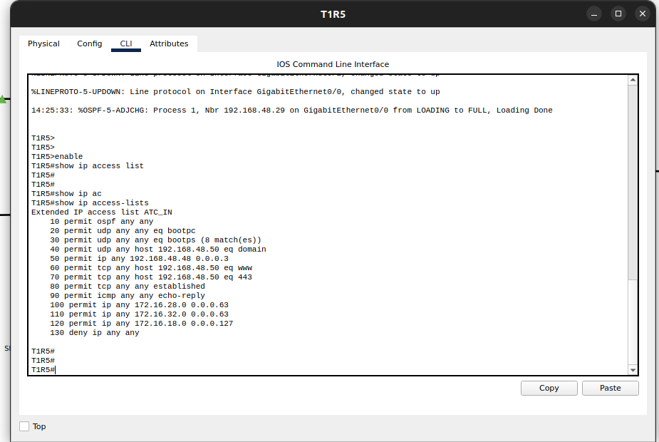 |
| `RN-R3` | `VENTAS_IN` y `FAC_IN` con contadores de coincidencias activos | 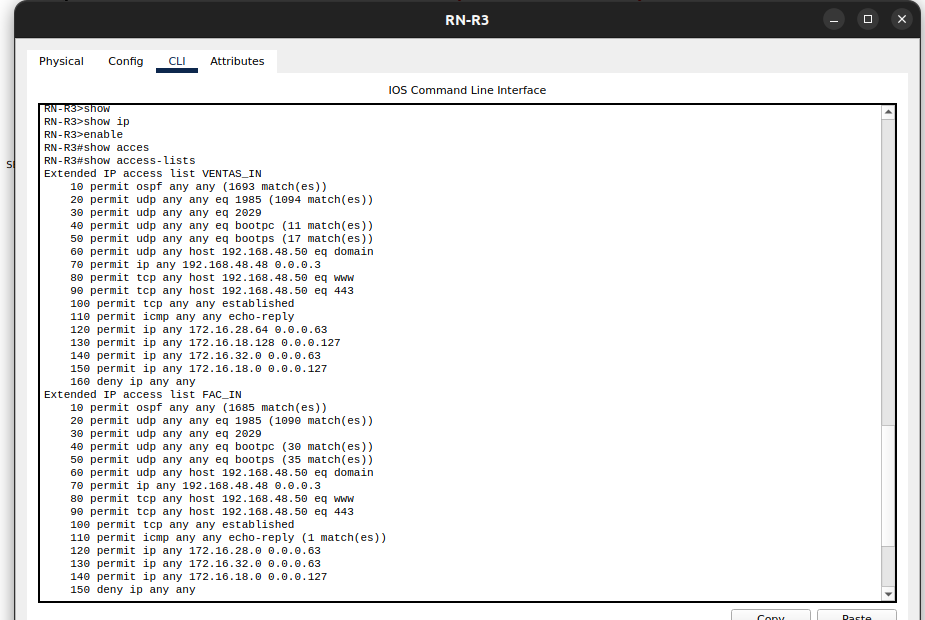 |
| `RN-R4` | `VENTAS_IN` y `FAC_IN` (idénticas, replicadas para el failover de HSRP) | 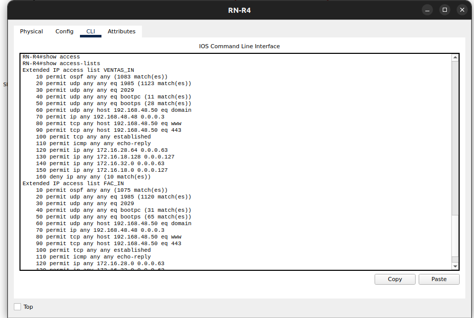 |
| `CF-R3` | `SEC_OUT` — 6 líneas, solo tráfico de retorno | 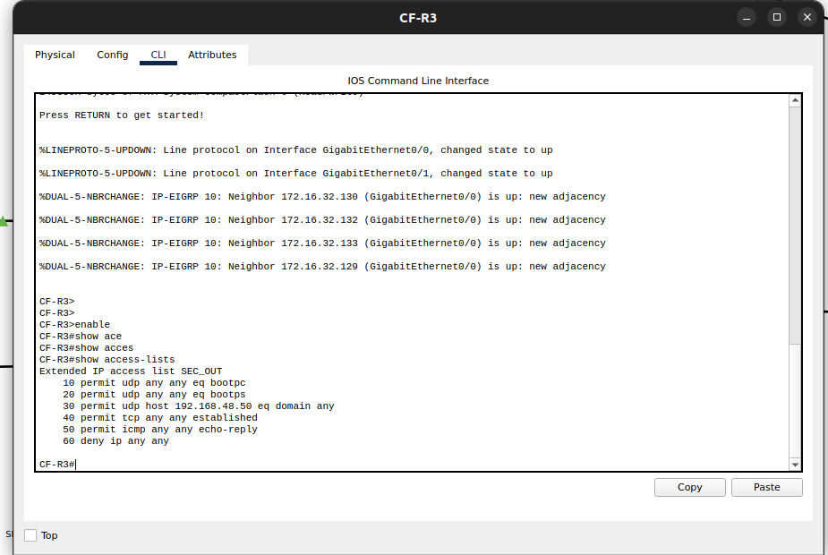 |

> En la captura de `RN-R3` se observan los contadores de la línea de HSRP (`1094 match(es)` en
> `permit udp any any eq 1985`) y de OSPF (`1693 match(es)`): son la prueba de que el bloque común del
> §5.1 está evitando el bloqueo del plano de control descrito en el §7.6.

### 5.4 Evidencia de verificación de las reglas (ping / PDU)

#### Seguridad — origen de las pruebas


#### Soporte


#### Ventas


#### Administración


#### Facturación


#### Atención al Cliente


---

## 6. Análisis de tráfico con Wireshark (sección 4.5 del enunciado)

Esta sección cubre el requisito **4.5** y la rúbrica **1.3 (14 puntos)**, además del requisito
eliminatorio de la rúbrica 8.1 (el archivo `.pcapng` debe existir y abrir correctamente).

| Elemento | Ubicación |
| :--- | :--- |
| Archivo de captura | `Wireshark/captura_wireshark_202300848.pcapng` (238 paquetes · 25,86 s · 166 kB) |
| Análisis capa por capa (con valores reales) | [`Wireshark/ANALISIS_WIRESHARK.md`](Wireshark/ANALISIS_WIRESHARK.md) |
| Capturas de pantalla | [`Wireshark/images/`](Wireshark/images/) (8 imágenes) |
| Instructivo completo de VirtualBox (paso a paso) | [`Wireshark/INSTRUCTIVO_VIRTUALBOX.md`](Wireshark/INSTRUCTIVO_VIRTUALBOX.md) |
| Script generador de tráfico | [`Wireshark/generar_trafico.sh`](Wireshark/generar_trafico.sh) |

**Entorno de captura (requisito 4.5):** **Oracle VirtualBox** sobre Windows, con **Kali Linux 2026.1**
como sistema invitado y el adaptador de red en modo **NAT** (`Intel PRO/1000 MT Desktop (NAT)`), lo que
garantiza que el tráfico capturado provenga únicamente de la VM y no del equipo anfitrión.
IP de la VM: `10.0.4.15`.


**Los cuatro escenarios capturados:**

| # | Escenario | Tráfico generado | Elementos identificados | Paquetes |
| :-: | :--- | :--- | :--- | :-: |
| 1 | Three-way handshake TCP | `curl -v http://example.com` | Flags `SYN`, `SYN-ACK`, `ACK`, números de secuencia (`X`, `X+1`, `Y`, `Y+1`) y ventana | 5 SYN |
| 2 | Resolución DNS | `dig @8.8.8.8` y `dig @1.1.1.1` | Tipos `A`, `AAAA` y `MX`; TTL 300/110/63; **UDP 53** | 26 |
| 3 | HTTP vs HTTPS | `curl http` y `curl https` | HTTP en texto plano (`GET /`, `200 OK`) vs **TLS 1.3** (`TLS_AES_128_GCM_SHA256`) con `Application Data` cifrado | 6 + 34 |
| 4 | ICMP | `ping -c 4 8.8.8.8` y `1.1.1.1` | Pares `Echo Request` (tipo 8) / `Echo Reply` (tipo 0), TTL 64→113, RTT 32–254 ms | 16 |

| | |
| :--- | :--- |
|  |  |
| **Escenario 1** — `tcp.flags.syn == 1` | **Escenario 2** — `dns` |
|  |  |
| **Escenario 3a** — `http.request` (texto plano) | **Escenario 3b** — `tls.handshake` (cifrado) |
|  |  |
| **Escenario 4** — `icmp` | **Resumen** — los 4 escenarios juntos |

**El análisis capa por capa de los cinco protocolos (TCP, DNS, HTTP, TLS e ICMP), con los valores
reales extraídos de la captura, está en
[`Wireshark/ANALISIS_WIRESHARK.md`](Wireshark/ANALISIS_WIRESHARK.md).**

---

## 7. Resolución de Problemas (Troubleshooting)

Durante el desarrollo del proyecto y las fases de prueba de conectividad se presentaron diversos
desafíos técnicos de alto nivel que fueron diagnosticados y resueltos exitosamente, demostrando el
dominio de las tecnologías empleadas.

### 7.1 Bucles de Enrutamiento por EIGRP Auto-Summary

- **Problema:** El switch multicapa de la interconexión BGP no podía hacer ping al router de Soporte
  (`CF-R2`), a pesar de que los equipos intermedios sí tenían conectividad.
- **Causa Raíz:** Se detectó que EIGRP estaba realizando una sumarización automática (`auto-summary`)
  en las fronteras de red con clase, anunciando la ruta global `172.16.0.0/16` en lugar de las
  subredes específicas `/26`. Esto causaba un choque de subredes con las otras redes ISP propagadas
  por BGP, ocasionando que los paquetes se enviaran al ISP equivocado.
- **Solución:** Se deshabilitó el resumen automático globalmente aplicando el comando
  `no auto-summary` en todos los procesos `router eigrp 10`. Esto forzó la propagación de prefijos
  específicos (Longest Prefix Match), habilitando el enrutamiento exitoso de extremo a extremo y
  restaurando las respuestas del servidor DHCP.

### 7.2 Bloqueo de DHCP por NAT Involuntario (Router Inalámbrico WRT300N)

- **Problema:** Los equipos de Soporte y la laptop no recibían direccionamiento IP del servidor DHCP
  centralizado, generando IPs `169.254.x.x` (APIPA).
- **Causa Raíz:** Se descubrió que el router inalámbrico WRT300N estaba conectado al switch principal
  a través del puerto `Internet` (WAN). Esto activaba la función de NAT nativa del dispositivo,
  bloqueando y descartando los paquetes de difusión `DHCP Discover`.
- **Solución:** Se migró el cable físico del puerto `Internet` hacia el puerto `Ethernet 1` del router
  WRT300N. Esta acción convirtió el equipo en un Bridge/Access Point transparente en capa 2,
  permitiendo que las solicitudes DHCP fluyeran libremente hacia el router `CF-R2` y su respectivo
  `ip helper-address`.

### 7.3 Conflictos por IPs Duplicadas (Inestabilidad en Adyacencias EIGRP)

- **Problema:** El protocolo EIGRP en la topología Hub and Spoke colapsaba constantemente, mostrando
  mensajes de consola `%DUAL-5-NBRCHANGE... retry limit exceeded`.
- **Causa Raíz:** Una auditoría de configuración reveló que dos routers (`CF-R2` y `CF-R3`) tenían la
  misma dirección IP asignada en su interfaz WAN, provocando tormentas de paquetes y negación del
  servicio de enrutamiento.
- **Solución:** Se corrigió el archivo de script de inicialización y se reconfiguraron las interfaces
  con las IPs correctas (`.130` y `.131`), estabilizando las adyacencias EIGRP en cuestión de segundos.

### 7.4 Intercambio de Cables e Interfaces Físicas Invertidas

- **Problema:** Fallo total de comunicación entre el router central (`CF-R1`) y el router de Soporte
  (`CF-R2`).
- **Causa Raíz:** Se identificó mediante inspección visual y análisis de la tabla de enrutamiento que
  las conexiones físicas de `CF-R2` estaban invertidas: la interfaz configurada para la red LAN estaba
  conectada al puerto hacia la WAN y viceversa.
- **Solución:** Se eliminaron los cables y se procedió a realizar un cableado estructurado correcto,
  respetando la estandarización (`Gig0/0` para WAN, `Gig0/1` para LAN), restableciendo la
  comunicación de Capa 3 inmediatamente.

### 7.5 Inestabilidad de Conexiones por Balanceo de Carga OSPF en Entorno HSRP

- **Problema:** Los pings desde Ventas hacia Soporte mostraban intermitencia severa (flapping),
  alternando entre paquetes exitosos y perdidos.
- **Causa Raíz:** Al contar con redundancia física obligatoria (cables cruzados) para soportar HSRP,
  OSPF interpretó ambas rutas hacia la LAN como de igual costo. Esto generó un balanceo de carga
  asimétrico en el retorno de los paquetes. La mitad del tráfico regresaba por el router Standby, el
  cual descartaba los paquetes debido a políticas locales o falta de estado.
- **Solución:** Se implementó enrutamiento simétrico manipulando la métrica de OSPF. Se aplicó
  `ip ospf cost 50` en las interfaces de respaldo cruzadas, forzando a OSPF a utilizar siempre el
  router Activo HSRP para el tráfico de retorno, solucionando la intermitencia de inmediato.

### 7.6 Caída de Redundancia y Enrutamiento por Listas de Control de Acceso (Split-Brain)

- **Problema:** Tras aplicar las ACLs estrictas, la red presentó colapsos, y ambos routers HSRP
  (`RN-R3` y `RN-R4`) se declararon en estado "Active".
- **Causa Raíz:** La sentencia implícita `deny ip any any` al final de las ACLs bloqueó los paquetes
  multicast internos necesarios para la adyacencia de los protocolos de control, específicamente los
  "Hello" de OSPF (protocolo 89) y de HSRP (UDP 1985/2029).
- **Solución:** Se incluyeron sentencias explícitas `permit ospf any any` y
  `permit udp any any eq 1985` **al inicio** de las ACLs extendidas (bloque común documentado en
  [`scripts/ACLs/README.md`](scripts/ACLs/README.md)), restableciendo la comunicación de los planos de
  control sin comprometer el plano de datos.

### 7.7 Ambigüedad de Reglas Administrativas (Conflictos de Tráfico)

- **Problema:** Los departamentos con reglas de salida estrictas (como Ventas y Facturación) no podían
  alcanzar a Soporte ni a Administración, a pesar de que estos últimos tenían la regla de
  "entrada desde todos".
- **Causa Raíz:** Un choque clásico de lógicas de firewall. Una regla estricta de salida en un origen
  bloquea el paquete antes de que pueda ser evaluado por la regla permisiva del destino. Además,
  ligeros desajustes en el tamaño de las subredes (VLSM) impedían el "match" exacto de la IP.
- **Solución:** Se interpretó a Soporte y Administración como **"excepciones globales"**. Se añadieron
  reglas de permiso explícitas hacia sus subredes usando origen `any` en las ACLs de los departamentos
  restrictivos, blindando la configuración contra problemas de subredes asimétricas.

### 7.8 Conflicto entre las reglas "Soporte ↔ todos" y "Nadie entra a Seguridad"

- **Problema:** La tabla de reglas del enunciado es contradictoria para el par Soporte ↔ Seguridad:
  Soporte debe poder comunicarse con *todos* los departamentos en ambos sentidos, pero ningún
  departamento debe tener tráfico de entrada a Seguridad.
- **Causa Raíz:** Ambas reglas no pueden cumplirse simultáneamente; no había un criterio explícito de
  precedencia.
- **Solución:** Se dio **prioridad a la regla más restrictiva** (la de Seguridad), criterio estándar de
  firewall, coherente además con el orden en que el enunciado lista las reglas y con la naturaleza
  aislada del departamento de Seguridad. La justificación quedó documentada en
  [`scripts/ACLs/ACL_SOPORTE.md`](scripts/ACLs/ACL_SOPORTE.md).

### 7.9 ACLs apuntando al servidor con la dirección antigua

- **Problema:** Al acceder a `www.proyecto2_202300848.com`, la página **no cargaba desde ningún
  departamento**, aunque el **ping al servidor sí funcionaba** desde todos.
- **Causa Raíz:** Al re-subnetear FibraNet GT a `/25` (§2.1), el servidor DNS/HTTP/HTTPS se movió de
  `172.16.18.130` a **`192.168.48.50`**, pero las ACLs (`ATC_IN`, `VENTAS_IN`, `FAC_IN` y `SEC_OUT`)
  seguían autorizando únicamente la **IP antigua**. Como terminan en `deny ip any any`, el **DNS
  (UDP 53)** y el **HTTP/HTTPS (TCP 80/443)** hacia el servidor nuevo quedaban bloqueados. El ICMP sí
  pasaba porque las reglas de ping entre departamentos son más amplias — de ahí el síntoma engañoso
  de "hay ping pero no hay página".
- **Solución:** Se sustituyeron los permisos por host por un único permiso al segmento del servidor
  (`permit ip any 192.168.48.48 0.0.0.3`), que cubre DNS, HTTP, HTTPS e ICMP. Se verificó con los
  contadores de coincidencias (`41 match(es)` en la línea de HTTP) y con el navegador desde una PC de
  cada departamento.

### 7.10 Enlace OSPF asimétrico y estado atascado del simulador

- **Problema:** `T1R3` no aparecía como vecino de ningún router y todo el subárbol
  {`T1R3`, `T1R5` y el servidor} quedó aislado: los PDU desde y hacia esos equipos fallaban, y en una
  PC de Administración el ping al servidor devolvía
  `Reply from 172.16.18.1: Destination host unreachable`.
- **Diagnóstico:** Ese mensaje **no lo genera el destino, sino el gateway del PC** (`T1R4`): significa
  que T1R4 **no tenía ruta** hacia `192.168.48.50`, es decir, un problema de **enrutamiento**, no de
  ACL ni del servidor. Se confirmó con `show ip ospf interface g0/2` en `T1R3` y en `T1R1`:
  **T1R3 decía tener 1 vecino adyacente (`192.168.48.34`) mientras T1R1 mostraba `Neighbor Count is 0`**
  sobre el mismo cable, y **ambos se declaraban DR** del mismo segmento — imposible si se escucharan
  mutuamente. El CDP lo confirmaba: T1R3 oía a T1R1, pero T1R1 no oía a T1R3.
- **Causa Raíz:** El enlace quedó en un estado **asimétrico** y el proceso OSPF con estado obsoleto
  tras renumerar las interfaces con el protocolo en ejecución. Una adyacencia OSPF exige tráfico en
  **ambos** sentidos, por lo que T1R1 nunca podía completarla.
- **Solución:** Se guardó el archivo y se **reinició Packet Tracer por completo** (los estados
  atascados de OSPF y CDP se limpian al recargar el proyecto), y se verificó el árbol con
  `show ip ospf neighbor` en los cinco routers de FibraNet GT. Complementariamente se recomendó fijar
  **router-ids explícitos** (`1.1.1.1` … `1.1.1.5`) para evitar que el router-id auto-electo conserve
  una dirección antigua tras renumerar, y usar `ip ospf network point-to-point` en los enlaces `/30`
  para eliminar la elección DR/BDR.

> **Diagnóstico reutilizable:** la lista de evidencias gráficas y los pendientes están en el §10.

---

## 8. Entregables

| Entregable | Ubicación |
| :--- | :--- | 
| Enlace al repositorio | UEDI (antes del 23/10/2026) |
| Archivo de simulación | `Proyecto2_202300848.pkt` |
| Manual técnico | Este `README.md` | 
| Captura de tráfico | `Wireshark/captura_wireshark_202300848.pcapng` | 
| Presentación ejecutiva | `Proyecto2_Presentacion_202300848.pdf` | 

---

## 9. Documentos de apoyo del repositorio

| Documento | Contenido |
| :--- | :--- |
| [`scripts/README.md`](scripts/README.md) | Índice de scripts, mapa de renombrado de ISPs y tabla comparativa de tecnologías |
| [`scripts/ACLs/README.md`](scripts/ACLs/README.md) | Justificación de cada ACL (interfaz y sentido in/out) |
| [`scripts/ACLs/MATRIZ_PRUEBAS.md`](scripts/ACLs/MATRIZ_PRUEBAS.md) | 24 pruebas ICMP + pruebas de servicios y de redundancia |
| [`Wireshark/ANALISIS_WIRESHARK.md`](Wireshark/ANALISIS_WIRESHARK.md) | Análisis capa por capa de los 4 escenarios capturados |
| [`PACKET_TRACER_CAMBIOS.md`](PACKET_TRACER_CAMBIOS.md) | Paso a paso para aplicar los cambios en el archivo `.pkt` |

---

## 10. Anexo: índice de figuras y pendientes

### 10.1 Índice de figuras

| Figura | Contenido |
| :--- | :--- | 
| `images/image.png` | Topología completa de los tres ISPs | 
| `images/image1.png` | FibraNet GT (topología en árbol) | 
| `images/image2.png` | AndinaCom (modelo jerárquico + HSRP) | 
| `images/image3.png` | MoonLink (hub-and-spoke + WRT300N) | 
| `images/image4.png` | `show ip route bgp` — rutas interdominio |
| `images/image15.png` | Acceso **HTTPS** a `www.proyecto2_202300848.com` desde Ventas | 
| `images/image16.png` · `image17.png` | **HSRP**: `RN-R3` Active / `RN-R4` Standby | 
| `images/image18.png` · `image19.png` · `image20.png` | **Vecinos eBGP** en los 3 switches de borde (+ EIGRP en MoonLink) | 
| `images/image21.png` | **EtherChannel LACP** `Po1(SU)` en `T1S2-ADMIN` | 
| `images/image22.png` | **DHCP** en `PC-Ventas2` (IP, gateway VIP de HSRP y DNS) | 
| `images/image11.png` – `image14.png` | `show ip access-lists` en `T1R5`, `RN-R3`, `RN-R4` y `CF-R3` | 
| `images/image5.png` … `image10.png` | Matrices de PDU: pruebas de ping entre departamentos | 
| `Wireshark/images/01` … `08` | Entorno VirtualBox/NAT y los 4 escenarios capturados |