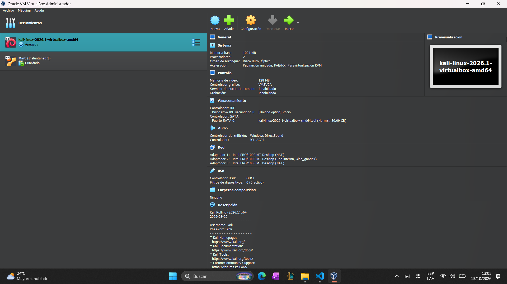
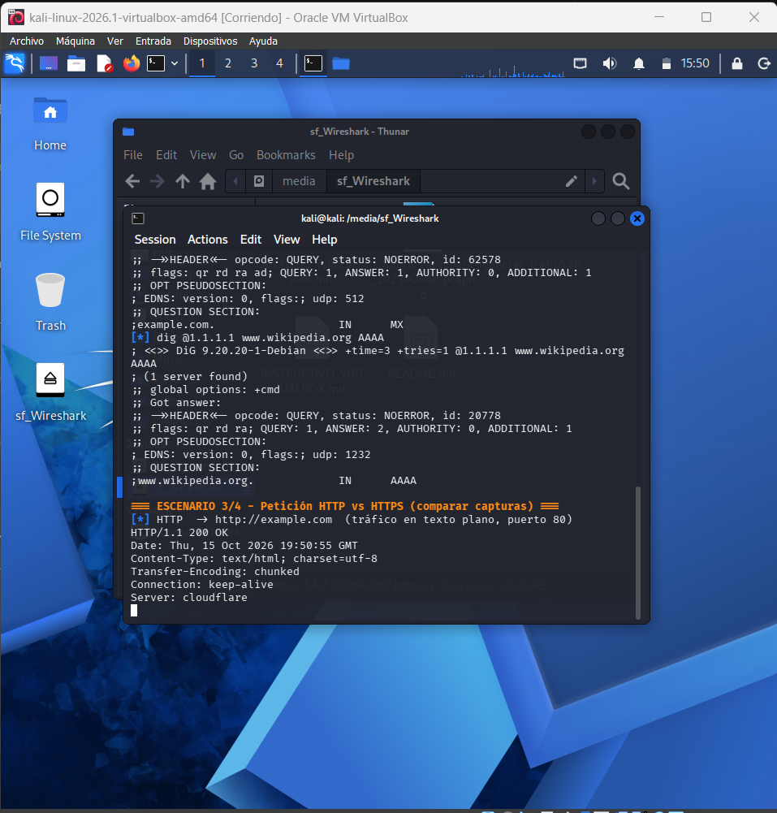
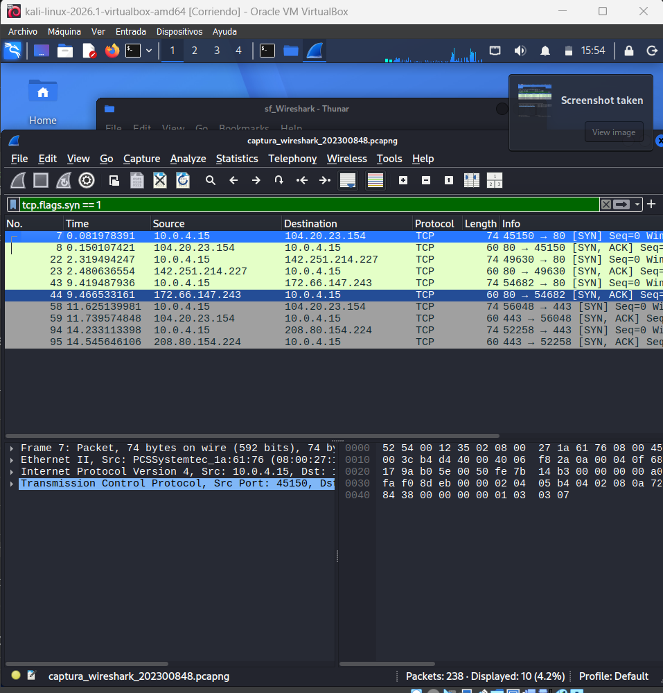
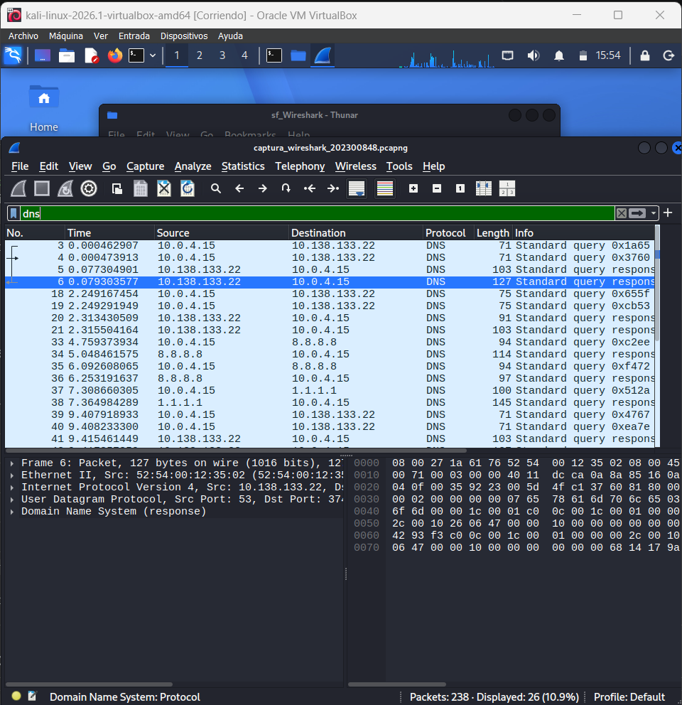
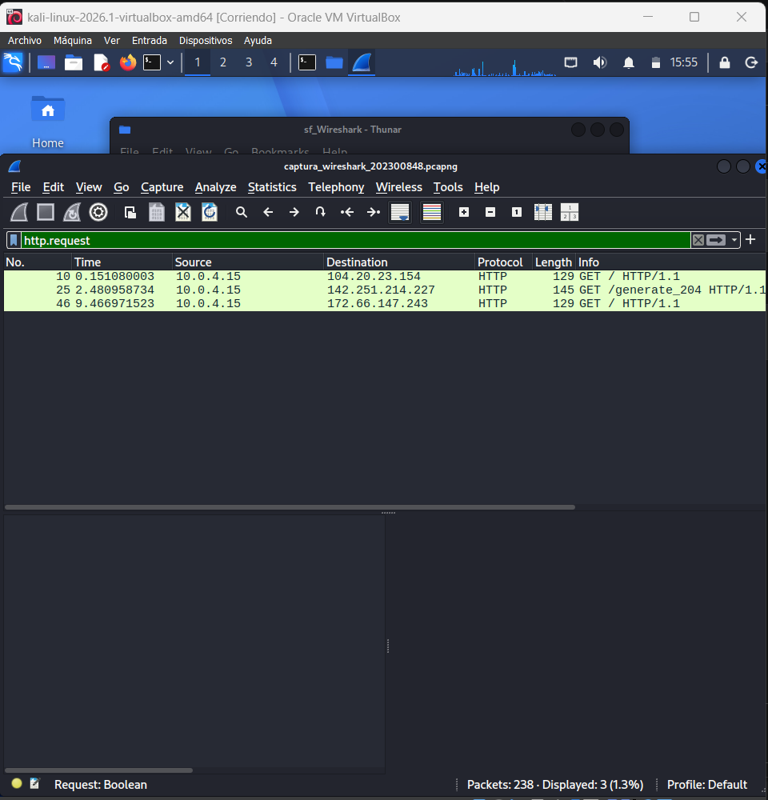
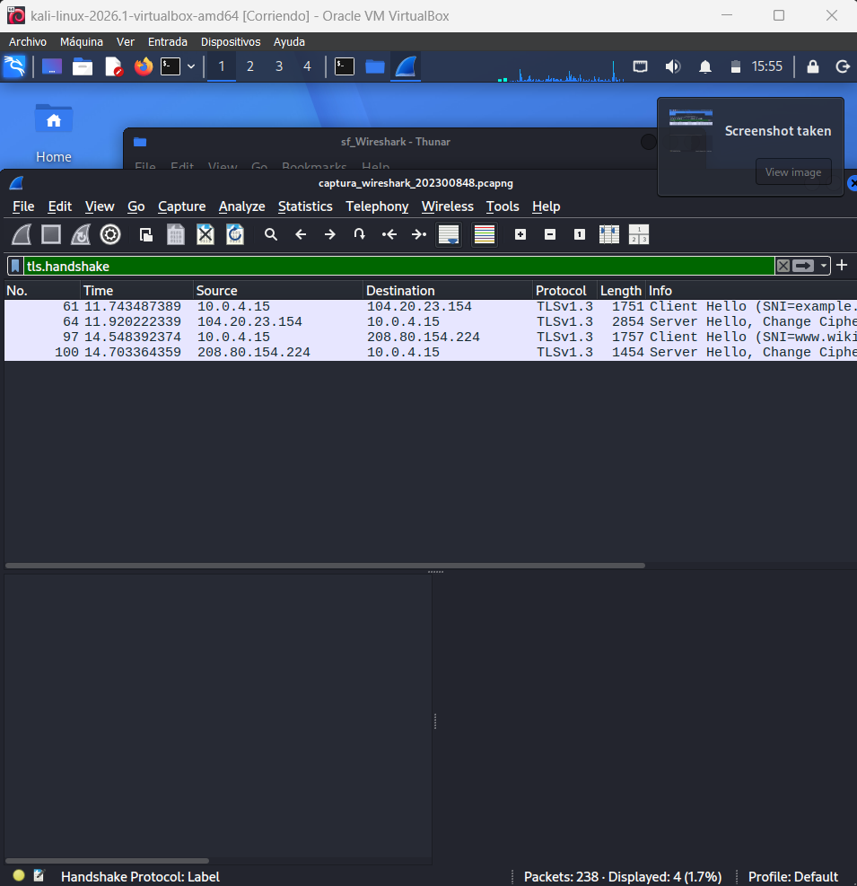
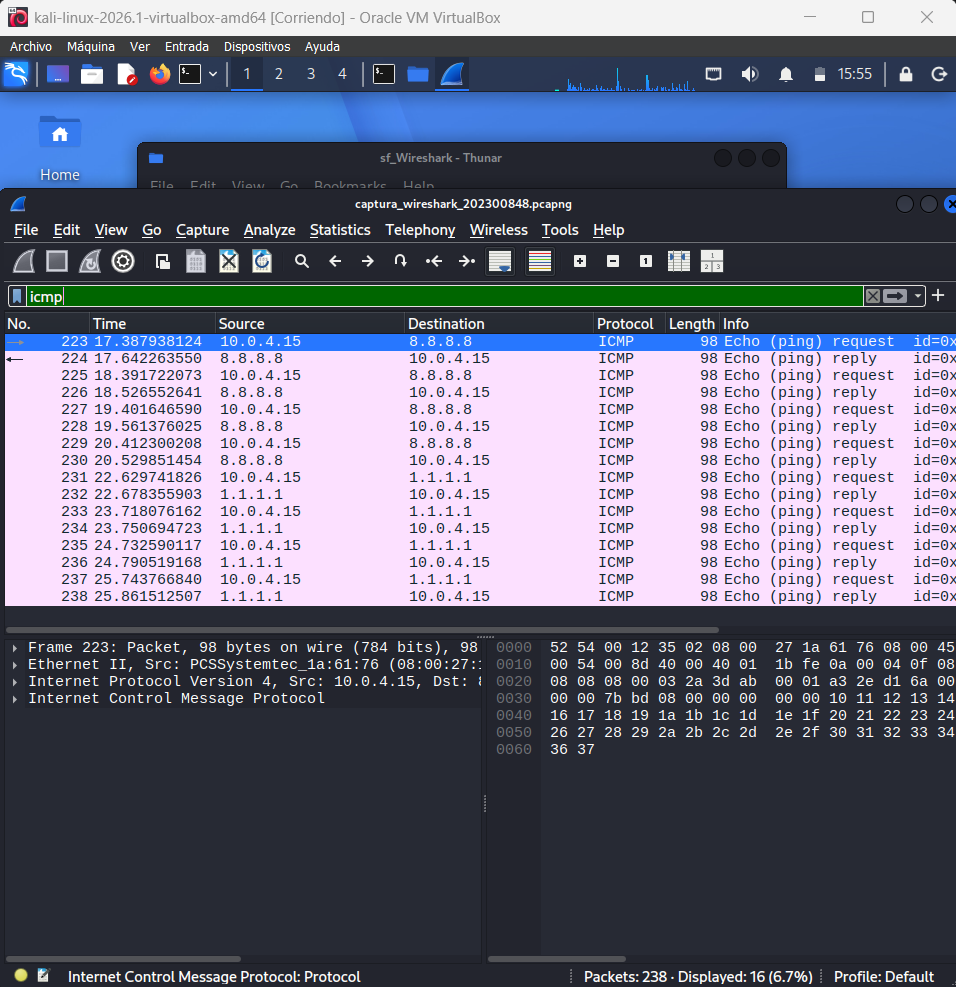
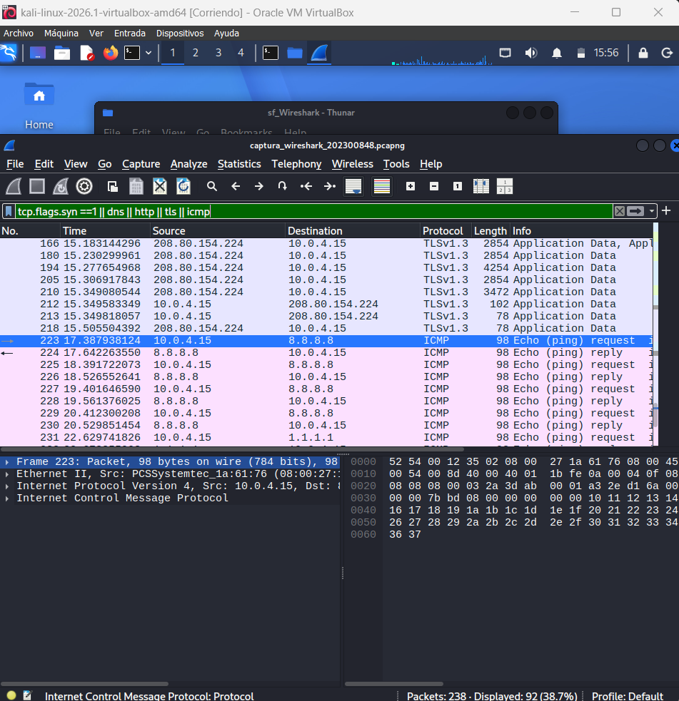

# Análisis de tráfico con Wireshark — Sección 4.5

**Estudiante:** Carné 202300848
**Curso:** Redes de Computadoras 2 · Proyecto 2
**Archivo de captura:** `captura_wireshark_202300848.pcapng`

| Dato de la captura | Valor |
| :--- | :--- |
| Hipervisor | **Oracle VirtualBox** (host Windows) |
| Sistema invitado | **Kali Linux 2026.1** (64 bits) |
| **Modo de red** | **NAT** (`Intel PRO/1000 MT Desktop (NAT)`) |
| IP de la máquina virtual | `10.0.4.15` |
| Paquetes capturados | **238** |
| Duración | **25,86 s** (15/10/2026 13:50:42 → 13:51:08) |
| Tamaño del archivo | 166 kB (pcapng, precisión de nanosegundos) |
| Herramienta de captura | `dumpcap` (invocado por el script `generar_trafico.sh`) |

> **Requisito 4.5 del enunciado:** *"La máquina virtual debe configurarse en modo NAT o Red interna
> para garantizar que el tráfico capturado provenga únicamente de la VM y no de la máquina anfitriona."*
> Se cumplió usando **NAT**: la VM sale a Internet a través del host, pero la interfaz capturada solo
> ve el tráfico originado y destinado a la propia VM.

**Evidencia del entorno de captura:**



*Configuración de la VM: Kali Linux 2026.1, 1024 MB de RAM, 2 CPU y —lo importante— el
**Adaptador 1 en modo NAT**.*



*La captura se generó **dentro** de la VM. Se observa la ventana del sistema invitado, el script en
ejecución (escenarios 2 y 3) y la carpeta compartida `/media/sf_Wireshark` por donde se transfirió
el archivo.*

---

## 0. Resumen del análisis

El enunciado exige documentar el análisis **capa por capa de al menos tres protocolos distintos**.
Esta captura contiene **cuatro escenarios** y se analizan **cinco protocolos**: TCP, DNS, HTTP, TLS
e ICMP (más el direccionamiento Ethernet/IP que los transporta).

| # | Escenario | Protocolo | Puerto / tipo | Paquetes en la captura |
| :-: | :--- | :--- | :--- | :-: |
| 1 | Three-way handshake TCP | TCP | 80 y 443 | 5 SYN + 5 SYN-ACK |
| 2 | Resolución DNS | DNS | UDP 53 | **26** |
| 3a | Petición HTTP | HTTP sobre TCP | TCP 80 | **3 peticiones** + 3 respuestas |
| 3b | Petición HTTPS | TLS sobre TCP | TCP 443 | **34 paquetes TLS** (4 de handshake) |
| 4 | ICMP | ICMP | tipo 8 / tipo 0 | **16** (8 request + 8 reply) |

**Filtros de visualización utilizados:**

```text
tcp.flags.syn == 1 && tcp.flags.ack == 0     ! SYN
tcp.flags.syn == 1 && tcp.flags.ack == 1     ! SYN-ACK
dns                                          ! consultas y respuestas DNS
http.request                                 ! petición HTTP en texto plano
tls.handshake                                ! handshake TLS
icmp                                         ! Echo Request / Echo Reply
```

---

## 1. Escenario 1 — Three-way handshake TCP

**Tráfico generado:** `curl -v http://example.com` y `curl http://www.gstatic.com/generate_204`.

### 1.1 Concepto

El *three-way handshake* es el procedimiento con el que TCP establece una conexión confiable antes de
enviar datos. Se llama de tres vías porque requiere tres mensajes:

```text
   Cliente                                              Servidor
      |  --------------- SYN  (seq = X) ------------------->  |   (1) "Quiero conectar"
      |                                                        |
      |  <-------- SYN-ACK (seq = Y, ack = X+1) -------------- |   (2) "Acepto, yo también quiero"
      |                                                        |
      |  --------------- ACK  (seq = X+1, ack = Y+1) --------> |   (3) "Confirmado, empecemos"
```

**Formación de la conexión:** el cliente elige un **ISN** (*Initial Sequence Number*) aleatorio `X` y
lo envía en el `SYN`. El servidor responde con su propio `SYN` con ISN `Y` y **reconoce** el del
cliente con `ack = X + 1`. Finalmente el cliente reconoce el del servidor con `ack = Y + 1`. A partir
de ahí los números de secuencia avanzan según la cantidad de bytes de datos transmitidos.

### 1.2 Evidencia en la captura

Conexión TCP hacia `example.com` (`104.20.23.154`), puerto 80:

| # | Origen | Destino | Flags | Seq | Ack | Ventana | Observación |
| :-: | :--- | :--- | :--- | --: | --: | --: | :--- |
| **7** | `10.0.4.15:45150` | `104.20.23.154:80` | **SYN** (`0x002`) | `4269479091` | 0 | 64240 | Inicio. El cliente propone ISN = X |
| **8** | `104.20.23.154:80` | `10.0.4.15:45150` | **SYN, ACK** (`0x012`) | `64001` | `4269479092` | 65535 | Acepta y propone su ISN = Y. `ack = X+1` |
| **9** | `10.0.4.15:45150` | `104.20.23.154:80` | **ACK** (`0x010`) | `4269479092` | `64002` | 64240 | Confirma. `ack = Y+1`. `Len = 0` |

Se capturaron **tres** conexiones completas:

| Conexión | Cliente | Puerto origen | Servidor | Client Seq (X) | Server Seq (Y) |
| :--- | :--- | --: | :--- | --: | --: |
| 1 | `10.0.4.15` | 45150 | `104.20.23.154:80` | 4269479091 | 64001 |
| 2 | `10.0.4.15` | 49630 | `142.251.214.227:80` | 1151299078 | 192001 |
| 3 | `10.0.4.15` | 54682 | `172.66.147.243:80` | 363856121 | 320001 |

**Dónde verlo en Wireshark:** filtro `tcp.flags.syn == 1` → *Displayed: 10 (4,2 %)*.
Clic derecho sobre el SYN → **Follow → TCP Stream** para ver la secuencia completa.



### 1.3 Análisis capa por capa del paquete `SYN` (frame 7)

| Capa | Campo | Valor observado | Explicación |
| :--- | :--- | :--- | :--- |
| **2 Enlace** | `Ethernet II` · Src MAC | `PCS5ystemtec_1a:61:76` | MAC de la interfaz de la VM |
| **2 Enlace** | Dst MAC | MAC de la puerta de enlace | El destino en la trama Ethernet **no** es la MAC del servidor remoto: capa 2 solo tiene alcance local |
| **2 Enlace** | Type | `0x0800` (IPv4) | La carga útil es un paquete IPv4 |
| **3 Red** | Version / IHL | `4` / `20 bytes` | Sin opciones: cabecera IP mínima |
| **3 Red** | Src / Dst IP | `10.0.4.15` → `104.20.23.154` | `10.0.4.15` es la IP privada que el **NAT de VirtualBox** asigna a la VM |
| **3 Red** | Protocol | `6` (TCP) | Multiplexación hacia la capa de transporte |
| **3 Red** | TTL (enviado) | `64` | Valor inicial típico de Linux; se decrementa en cada salto |
| **4 Transporte** | Src Port | `45150` | Puerto **efímero** elegido por el sistema operativo |
| **4 Transporte** | Dst Port | `80` | Puerto *well-known* de HTTP |
| **4 Transporte** | Flags | `SYN = 1`, resto en 0 (`0x002`) | Solicitud de sincronización |
| **4 Transporte** | Sequence Number | `4269479091` (relativo: `0`) | ISN del cliente |
| **4 Transporte** | Acknowledgment | `0` | No se reconoce nada todavía |
| **4 Transporte** | Window Size | `64240` | Control de flujo: bytes que puede recibir sin confirmar |
| **4 Transporte** | Options | MSS, SACK Permitted, Timestamps | Negociación de parámetros TCP |

---

## 2. Escenario 2 — Resolución DNS

**Tráfico generado:** `dig @8.8.8.8 example.com A`, `dig @8.8.8.8 example.com MX` y
`dig @1.1.1.1 www.wikipedia.org AAAA`.

### 2.1 Concepto

DNS traduce nombres de dominio a direcciones IP. Para ello envía una **consulta** (Query) y recibe
una **respuesta** (Response) sobre **UDP puerto 53** (usa TCP 53 cuando la respuesta excede 512 bytes
o en transferencias de zona). Cada registro tiene un **TTL** (*Time To Live*) que indica cuántos
segundos puede conservarse en caché antes de volver a preguntar.

| Tipo | Significado | Ejemplo observado |
| :--- | :--- | :--- |
| **A** | Dirección IPv4 | `example.com → 104.20.23.154` |
| **AAAA** | Dirección IPv6 | `www.wikipedia.org → 2620:0:861:ed1a::1` |
| **MX** | Servidor de correo | `example.com → 0 .` |

### 2.2 Evidencia en la captura

**Consultas explícitas a los servidores públicos exigidos por el enunciado:**

| # | Origen | Servidor DNS | Consulta | Tipo | Respuesta | TTL |
| :-: | :--- | :--- | :--- | :--- | :--- | --: |
| 33 | `10.0.4.15` | **`8.8.8.8`** | `example.com` | **A** (1) | `104.20.23.154`, `172.66.147.243` | **300** |
| 35 | `10.0.4.15` | **`8.8.8.8`** | `example.com` | **MX** (15) | `0 .` | **110** |
| 37 | `10.0.4.15` | **`1.1.1.1`** | `www.wikipedia.org` | **AAAA** (28) | `2620:0:861:ed1a::1` | **63** |

**Consultas al resolver del sistema (necesarias antes de conectarse):**

| # | Servidor | Consulta | Tipo | Respuesta | TTL |
| :-: | :--- | :--- | :--- | :--- | --: |
| 3 | `10.138.133.22` | `example.com` | A | `104.20.23.154`, `172.66.147.243` | 44 |
| 4 | `10.138.133.22` | `example.com` | AAAA | `2606:4700:10::ac42:93f3` | 44 |
| 18 | `10.138.133.22` | `www.gstatic.com` | A | `142.251.214.227` | **245** |
| 90 | `10.138.133.22` | `www.wikipedia.org` | A/AAAA | – | 86283 |

**Datos exigidos por el enunciado:**

| Parámetro | Valor observado |
| :--- | :--- |
| **Tipo de registro** consultado | `A` (1), `AAAA` (28) y `MX` (15) |
| **TTL** de las respuestas | 300 y 110 (vía 8.8.8.8) · 44, 245 y 86283 (vía el resolver local) |
| **Puerto y protocolo** de transporte | **UDP 53** (26 tramas DNS en total) |
| Servidores DNS consultados | **`8.8.8.8`** (Google) y **`1.1.1.1`** (Cloudflare) |
| Longitud de la consulta | 71–75 bytes; respuestas de 91–145 bytes |
| Flag `Recursion desired` | `1` — el cliente pide resolución recursiva |
| Puerto de origen del cliente | efímero (p. ej. 44668) |



### 2.3 Análisis capa por capa de la consulta DNS

| Capa | Campo | Valor observado | Explicación |
| :--- | :--- | :--- | :--- |
| **2 Enlace** | Src / Dst MAC | VM → puerta de enlace | El paquete sale hacia el gateway de la VM |
| **3 Red** | Protocol | `17` (UDP) | DNS usa UDP por ser consultas cortas y sin necesidad de conexión |
| **3 Red** | Src / Dst IP | `10.0.4.15` → `8.8.8.8` | Destino externo (servidor público de Google) |
| **3 Red** | TTL (respuesta) | `113` | 128 − 15 saltos ≈ servidor Unix/Linux |
| **4 Transporte** | Src Port | efímero (44668) | Puerto aleatorio del cliente |
| **4 Transporte** | Dst Port | **`53`** | Puerto estándar del servicio DNS |
| **4 Transporte** | Length | 8 bytes de cabecera + datos | UDP no tiene handshake ni control de flujo |
| **7 Aplicación** | Transaction ID | `0xcea` y dinámicos | Empareja cada consulta con su respuesta |
| **7 Aplicación** | Flags | `0x0100` (query) / `0x8180` (response) | Consulta estándar y respuesta con *recursion available* |
| **7 Aplicación** | Queries / Answers | `example.com: type A, class IN` | Nombre, tipo y clase del registro |

> **Relación con el proyecto:** en la topología de Packet Tracer este mismo mecanismo se usa cuando
> una PC escribe `www.proyecto2_202300848.com`; el servidor DNS de FibraNet GT (`192.168.48.50`)
> responde con la consulta tipo **A** hacia toda la red.

---

## 3. Escenario 3 — Petición HTTP vs HTTPS

**Tráfico generado:** `curl http://example.com` (HTTP) y `curl https://example.com` +
`curl https://www.wikipedia.org` (HTTPS).

### 3.1 Comparación directa

| Característica | HTTP | HTTPS |
| :--- | :--- | :--- |
| Puerto de destino | **80** | **443** |
| Protocolo de aplicación | HTTP | HTTP **sobre TLS 1.3** |
| Confidencialidad | ❌ Texto plano, legible en Wireshark | ✅ Cifrado |
| Visibilidad del contenido | Se ve `GET / HTTP/1.1`, las cabeceras y el HTML | Solo `Application Data` binario |
| Integridad / autenticidad | ❌ Sin verificación del servidor | ✅ Certificado X.509 + firmas |
| Overhead | Menor (sin handshake criptográfico) | Mayor (handshake TLS + cifrado) |
| Filtro de Wireshark | `http` / `http.request` | `tls` / `tls.handshake` |
| Paquetes en la captura | 3 peticiones | 34 paquetes TLS |

### 3.2 Por qué el contenido de HTTPS aparece cifrado

HTTPS = HTTP + **TLS**. El cifrado es **simétrico** (AES-GCM) porque es rápido, pero las claves
simétricas se negocian de forma **asimétrica** (ECDHE + RSA/ECDSA) mediante el *handshake* TLS, que
además autentica al servidor con su certificado. Wireshark no puede descifrar el contenido porque:

1. La clave de sesión se deriva de un **secreto compartido** calculado con intercambio de claves
   Diffie-Hellman efímero (ECDHE), que **no viaja por la red**.
2. Solo el cliente y el servidor conocen los secretos; una captura pasiva no basta para derivarlos.
3. **TLS 1.3** añade *forward secrecy*: aunque se comprometiera la clave privada del servidor en el
   futuro, las sesiones pasadas seguirían siendo indescifrables.

En la captura se observa la secuencia completa:

```text
   TCP SYN → SYN-ACK → ACK                          (conexión TCP al puerto 443)
   Client Hello        (TLS 1.3, SNI = example.com, 88 cipher suites ofrecidas)
   Server Hello        (cipher suite elegida: 0x1301) + Change Cipher Spec
   Certificate, Server Key Exchange, Server Hello Done
   Client Key Exchange, Change Cipher Spec, Finished
   Application Data  ← a partir de aquí TODO el contenido HTTP va cifrado
```

### 3.3 Evidencia en la captura

**HTTP (texto plano, puerto 80):**

| # | Método | Host | URI | User-Agent | Respuesta |
| :-: | :--- | :--- | :--- | :--- | :--- |
| **10** | `GET` | `example.com` | `/` | `curl/8.18.0` | **`200 OK`** (frame 12) |
| **25** | `GET` | `www.gstatic.com` | `/generate_204` | `curl/8.18.0` | **`204`** (frame 27) |
| **46** | `GET` | `example.com` | `/` | `curl/8.18.0` | **`200 OK`** (frame 48) |

En el terminal se ve la respuesta completa en texto plano:

```text
HTTP/1.1 200 OK
Date: Thu, 15 Oct 2026 19:50:55 GMT
Content-Type: text/html; charset=utf-8
Transfer-Encoding: chunked
Connection: keep-alive
Server: cloudflare
```



**HTTPS (TLS, puerto 443):**

| # | Origen | Destino | Handshake | Versión | Cipher suite | SNI |
| :-: | :--- | :--- | :--- | :--- | :--- | :--- |
| **61** | `10.0.4.15` | `104.20.23.154` | **Client Hello** | `0x0303` | 88 suites ofrecidas | `example.com` |
| **64** | `104.20.23.154` | `10.0.4.15` | **Server Hello**, Change Cipher Spec | **TLSv1.3** | **`0x1301`** | – |
| **97** | `10.0.4.15` | `208.80.154.224` | **Client Hello** | `0x0303` | 88 suites ofrecidas | `www.wikipedia.org` |
| **100** | `208.80.154.224` | `10.0.4.15` | **Server Hello**, Change Cipher Spec | **TLSv1.3** | **`0x1301`** | – |

**Datos exigidos por el enunciado:**

| Parámetro | Valor observado |
| :--- | :--- |
| **Versión de TLS negociada** | **TLS 1.3** (Wireshark muestra `TLSv1.3`) |
| **Cipher suite elegida** | **`0x1301` = `TLS_AES_128_GCM_SHA256`** |
| ¿Se ve el HTML en la captura HTTPS? | **No** — aparece como `Application Data` (12 paquetes) |
| ¿Se ve el HTML en la captura HTTP? | **Sí**, en texto plano (`data-text-lines`, 2 paquetes) |
| SNI (nombre del servidor) | **Sí es visible**: `example.com` y `www.wikipedia.org` |



---

## 4. Escenario 4 — ICMP

**Tráfico generado:** `ping -c 4 8.8.8.8` y `ping -c 4 1.1.1.1`.

### 4.1 Concepto

`ping` utiliza el protocolo **ICMP** (encapsulado directamente en IP, sin TCP ni UDP) para verificar
alcanzabilidad y medir el RTT (*Round Trip Time*). Envía un mensaje **Echo Request (tipo 8)** y espera
un **Echo Reply (tipo 0)** del mismo tamaño. No hay puertos: el emparejamiento se hace con el
**Identifier** y el **Sequence Number**.

### 4.2 Evidencia en la captura

| # | Origen | Destino | Tipo ICMP | Seq | Bytes en trama | TTL | Tiempo relativo |
| :-: | :--- | :--- | :--- | --: | --: | --: | --: |
| 223 | `10.0.4.15` | `8.8.8.8` | **8** (Echo Request) | 1 | 98 | **64** | 17,387938 |
| 224 | `8.8.8.8` | `10.0.4.15` | **0** (Echo Reply) | 1 | 98 | **113** | 17,642264 |
| 225 | `10.0.4.15` | `8.8.8.8` | **8** (Echo Request) | 2 | 98 | 64 | 18,391722 |
| 226 | `8.8.8.8` | `10.0.4.15` | **0** (Echo Reply) | 2 | 98 | 113 | 18,526553 |
| 227–230 | ídem | ídem | 8 / 0 | 3 y 4 | 98 | 64 / 113 | 19,40 – 20,53 |
| 231–238 | `10.0.4.15` ↔ `1.1.1.1` | ídem | 8 / 0 | 1–4 | 98 | 64 / 113 | 22,63 – 25,86 |

**Datos exigidos por el enunciado:**

| Parámetro | `8.8.8.8` | `1.1.1.1` |
| :--- | :--- | :--- |
| Paquetes enviados / recibidos | 4 / 4 (0 % de pérdida) | 4 / 4 (0 % de pérdida) |
| **RTT mínimo** | **117,6 ms** | **32,6 ms** |
| **RTT promedio** | **166,6 ms** | **64,2 ms** |
| **RTT máximo** | **254,3 ms** | **117,7 ms** |
| TTL del Echo Reply | 113 (inicial 128 − 15 saltos) | 113 |
| Tamaño de la trama | 98 bytes (74 de IP + 8 de ICMP + 16 de relleno) | 98 bytes |
| Tipo de ICMP | `8` request / `0` reply | `8` request / `0` reply |



### 4.3 Análisis capa por capa del Echo Request

| Capa | Campo | Valor observado | Explicación |
| :--- | :--- | :--- | :--- |
| **2 Enlace** | Dst MAC | Puerta de enlace | Destino fuera de la subred → va al router |
| **3 Red** | Protocol | `1` (ICMP) | ICMP viaja **directamente sobre IP**, no sobre TCP/UDP |
| **3 Red** | Src / Dst IP | `10.0.4.15` → `8.8.8.8` | Traducidas por el **NAT** de la máquina virtual |
| **3 Red** | TTL | `64` al enviar, `113` al recibir | El valor inicial revela el sistema origen: 64 = Linux, 128 = Windows/Unix |
| **3 Red** | Identification / Flags | dinámico / `DF` | Fragmentación y control de MTU |
| **4 ICMP** | Type = `8` | Echo Request | Solicitud de eco |
| **4 ICMP** | Code = `0` | – | Código estándar |
| **4 ICMP** | Checksum | verificado por Wireshark | Integridad de la cabecera ICMP |
| **4 ICMP** | Identifier / Sequence | `0x0010` / `1..4` | Empareja solicitudes y respuestas del mismo proceso `ping` |
| **4 ICMP** | Data | Relleno incremental `16 17 18 19 …` | Patrón que incluye la marca de tiempo para medir el RTT |

> **Relación con el proyecto:** el ping es la herramienta con la que se validan las **ACLs** de la
> topología (ver [`../scripts/ACLs/MATRIZ_PRUEBAS.md`](../scripts/ACLs/MATRIZ_PRUEBAS.md)). Un
> `Echo Request` bloqueado por una ACL se manifiesta en Packet Tracer como `Request timed out`,
> exactamente igual que en esta captura cuando un destino no responde.

---

## 5. Resumen de la captura completa

Filtro combinado `tcp.flags.syn == 1 || dns || http || tls || icmp` → **Displayed: 92 (38,7 %)** de
238 paquetes, es decir, **los cuatro escenarios en una sola vista**:



| Protocolo | Tramas | Bytes |
| :--- | --: | --: |
| `arp` | 2 | 102 |
| `udp` → `dns` | 26 | 2 514 |
| `tcp` → `http` | 6 (3 peticiones) | 2 564 |
| `tcp` → `tls` | 34 (4 de handshake) | 45 877 |
| `icmp` | 16 | 1 568 |
| **Total** | **238** | **157 851** |

---

## 6. Conclusión del análisis

La captura demuestra de forma práctica, y a nivel de paquete, los conceptos del proyecto:

1. **TCP** establece conexiones con un handshake de tres vías y usa números de secuencia para
   garantizar la entrega ordenada — el mismo mecanismo que transporta **BGP (TCP 179)** entre los tres
   ISP de la topología.
2. **DNS** resuelve nombres con consultas **UDP/53** y respuestas con **TTL** — el servicio que en la
   topología provee **FibraNet GT** a toda la red (`www.proyecto2_202300848.com` → `192.168.48.50`).
3. **HTTP y HTTPS** comparten el modelo petición/respuesta, pero HTTPS añade una capa **TLS 1.3**
   (`TLS_AES_128_GCM_SHA256`) que aporta confidencialidad, integridad y autenticidad; el precio es un
   handshake adicional y mayor uso de CPU. **El contenido cifrado es indescifrable en una captura
   pasiva.**
4. **ICMP** opera sobre IP y es la herramienta básica de diagnóstico — la evidencia usada para validar
   las **ACLs** y la conectividad extremo a extremo en Packet Tracer.

El análisis se realizó **capa por capa**, distinguiendo el direccionamiento de **enlace** (MAC local
de la puerta de enlace) del direccionamiento de **red** (IP extremo a extremo, traducida por NAT), el
direccionamiento de **transporte** (puertos y números de secuencia) y la carga útil de **aplicación**
(legible en HTTP, opaca en HTTPS).

**Cumplimiento del enunciado 4.5:** ✅ los cuatro escenarios están presentes en un único archivo
`.pcapng` válido, capturado íntegramente **dentro de una máquina virtual en modo NAT**.
